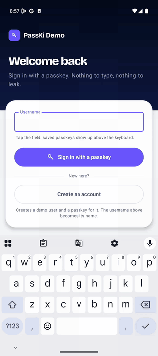
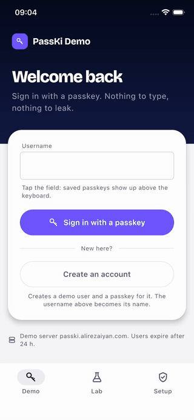
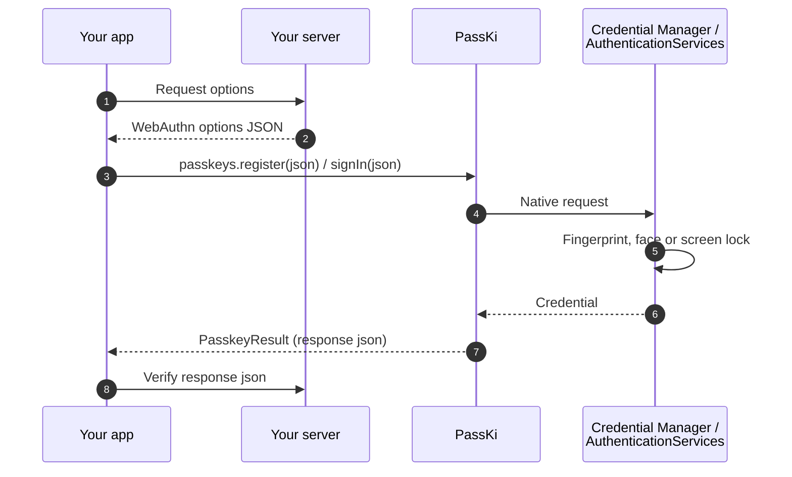
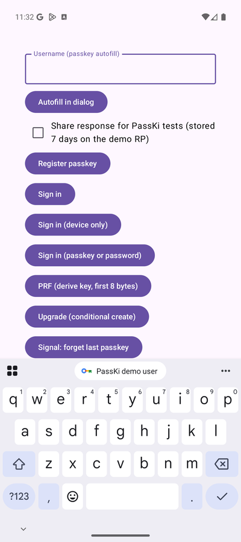
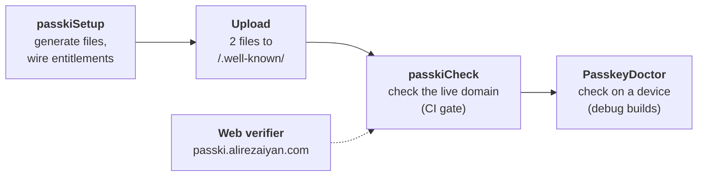
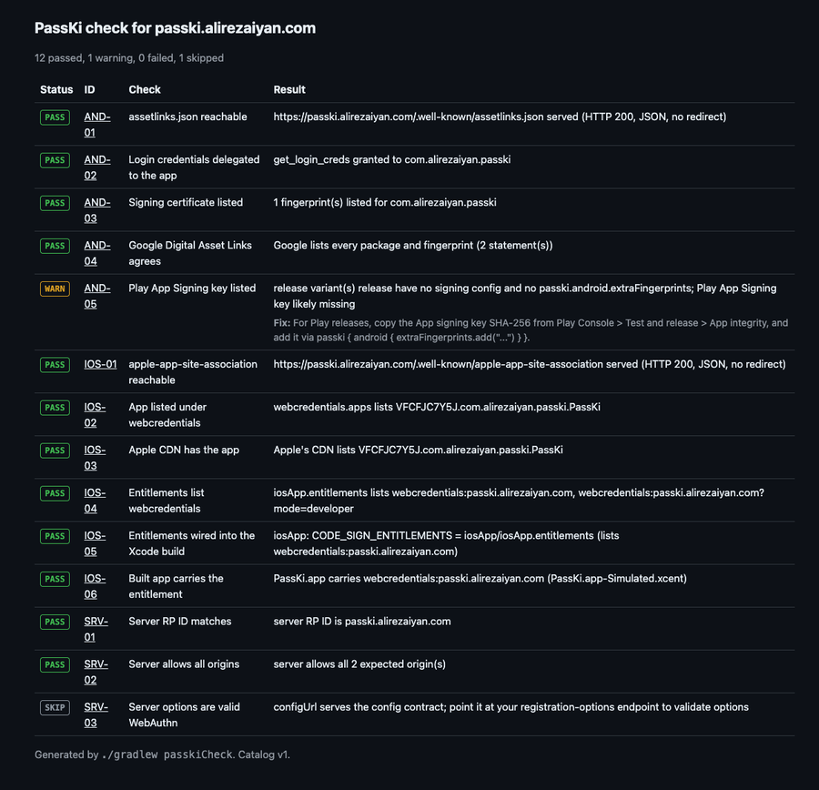
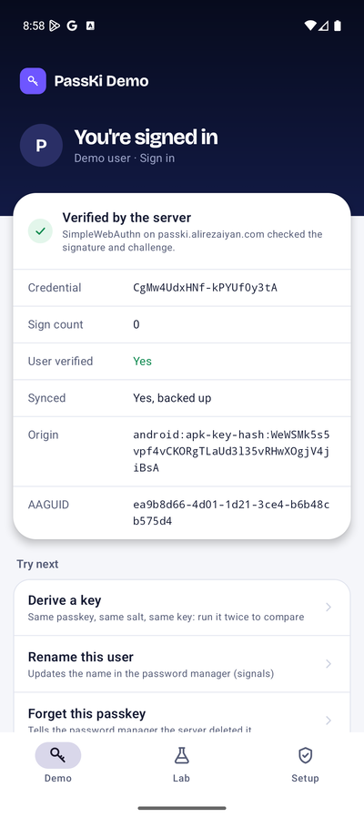
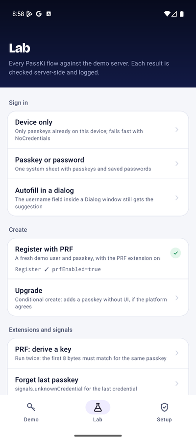
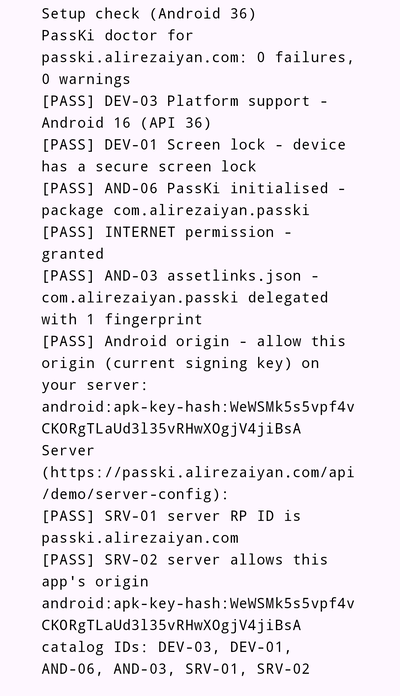

<h1 align="center">PassKi</h1>

<p align="center">
  <b>Passkeys for Kotlin Multiplatform.</b><br>
  One dependency, one call, native authenticators, and errors that tell you how to fix them.
</p>

<p align="center">
  
  
  
  
  
</p>

<table align="center">
  <tr>
    <th>Android 16 · Google Password Manager</th>
    <th>iOS 26.3 · Face ID</th>
  </tr>
  <tr>
    <td></td>
    <td></td>
  </tr>
</table>

<p align="center"><sub>
  The <a href="#sample-app">sample app</a>: <b>Create an account</b> makes a passkey, the demo server checks the
  response (<b>Verified by the server</b>), then <b>Sign in with a passkey</b> after signing out. On Android the
  screen-lock PIN screen is cut out because the system hides it from screen recording, and the Google account address
  is blurred.
</sub></p>

Your server creates WebAuthn options and checks the response. PassKi shows the native passkey sheet in between, from
`commonMain`:

```kotlin
val passkeys = Passkeys() // no Activity, no UIWindow

passkeys.register(api.registrationOptions())         // options JSON from your server
    .onSuccess { api.finishRegistration(it.json) }  // your server checks the response

passkeys.signIn(api.authenticationOptions())
    .onSuccess { api.finishSignIn(it.json) }
```

Full example with error handling: [Usage](#usage).

---

**Contents:**
[Get started](#get-started) ·
[Words used here](#words-used-here) ·
[Why PassKi](#why-passki) ·
[How it works](#how-it-works) ·
[Install](#install) ·
[Usage](#usage) ·
[Platforms](#platforms) ·
[Compose](#compose) ·
[Testing](#test-without-devices) ·
[Setup](#setup) ·
[Sample app](#sample-app) ·
[Good to know](#good-to-know) ·
[More docs](#more-docs)

## Get started

A passkey works only when three things trust each other: your app, a domain you own, and a server that checks each
sign-in. PassKi handles the app side and helps you set up the other two. New to the terms? See
[Words used here](#words-used-here).

Pick a path:

| Path | Answers | What you need |
|---|---|---|
| [A. Run the sample](#a-run-the-sample) | Does PassKi work? | Android: nothing. iOS: your Apple Team ID |
| [B. Try it in your app](#b-try-it-in-your-app) | Does it work in my app? | Nothing more: the demo server stands in for your domain and server |
| [C. Ship it](#c-ship-it) | How do I use my own domain and server? | Your domain and a WebAuthn server |
| [D. Ship it without the plugin](#d-ship-it-without-the-plugin) | I already have my own signing and well-known setup | The same, set up by hand |

Paths B and C use the same Gradle tasks. Every task prints what it changes and what it sends. Add `--preview` to see
that before anything happens.

### A. Run the sample

You need a device that can hold a passkey:

- **Android 9+:** a phone, or an emulator with a Google Play system image. Sign in to a Google account and set a
  screen lock.
- **iOS 16+:** an iPhone, or a simulator with **Features → Face ID → Enrolled**.
- **Browser:** a current Chrome, Edge, Safari or Firefox, with a passkey provider (the browser's password manager, a
  phone, or a security key).

Then:

1. Clone this repository and open it in Android Studio.
2. **Android:** run `androidApp`. There is nothing to set up in the project: the demo server already trusts the
   sample's debug key.
3. **iOS:** copy `iosApp/Configuration/Local.xcconfig.example` to `iosApp/Configuration/Local.xcconfig`, and set
   `TEAM_ID` to your Apple Developer Team ID. Git ignores this file.
4. **iOS:** run `./gradlew passkiSetup`. It registers your build of the sample with the demo server. Then run `iosApp`
   from Xcode.
5. **Browser:** run `./gradlew :webApp:wasmJsBrowserDevelopmentRun` (or `:webApp:jsBrowserDevelopmentRun`) and open
   http://localhost:8080. There is nothing to set up.

When the app starts, it checks its setup. If something is wrong, a banner names the problem, and tapping it opens the
fix. More in [Sample app](#sample-app).

CI follows this path on every push to `main`: a fresh clone builds the Android sample, then runs `passkiSetup --preview`
and `passkiCheck` against the demo server.

### B. Try it in your app

The demo server at [passki.alirezaiyan.com](https://passki.alirezaiyan.com) creates real challenges and checks every
response. Use it to try PassKi, not in production: it deletes its users after 24 hours.

1. Add `passki` and the demo server client:

   ```kotlin
   commonMain.dependencies {
       implementation("com.alirezaiyan.passki:passki:0.1.0-alpha03")
       implementation("com.alirezaiyan.passki:passki-demo:0.1.0-alpha03")
   }
   ```

2. In your Android app module, apply the Gradle plugin and point it at the demo server:

   ```kotlin
   plugins {
       id("com.alirezaiyan.passki") version "0.1.0-alpha03"
   }

   passki {
       useDemoServer() // instead of rpId = "your.domain"
   }
   ```

   The plugin also sets up your iOS app. It finds the Xcode project in `iosApp/`, where the KMP template puts it. If
   yours is somewhere else, set `passki { apple { xcodeProject = ... } }`; see [all options](docs/setup.md#all-options).

3. Run `./gradlew passkiSetup`. It does two things:
   - It adds the demo domain to your iOS app's associated domains.
   - It registers your app with the demo server for 7 days.

   It prints exactly what it sends: package names, signing key fingerprints and Apple app IDs. These are all public.
   Run it with `--preview` first to see the output without sending anything.

4. Create a passkey, then sign in with it. The demo server provides the options and checks the result:

   ```kotlin
   val passkeys = Passkeys()
   val demo = PasskiDemoServer()
   passkeys.register(demo.registrationOptions("alice"))
       .onSuccess { println(demo.verifyRegistration(it.json)) } // verified by server ✓ signCount 0 …
   passkeys.signIn(demo.authenticationOptions())
       .onSuccess { println(demo.verifyAuthentication(it.json)) }
   ```

5. Optional: run `./gradlew passkiCheck` to check the whole setup.

On Android, Google caches which apps a domain trusts. A newly registered app can take a few minutes to work. Check
AND-04 in `passkiCheck` passes once Google has picked it up.

### C. Ship it

1. [Install](#install) PassKi. Your app talks to your server in four places; see [Usage](#usage).
2. Apply the Gradle plugin with `passki { rpId = "example.com" }` (your domain), and run `./gradlew passkiSetup`.
3. Upload the two files it lists to `https://example.com/.well-known/`.
4. Configure your server with the RP ID and the allowed origins that `passkiSetup` printed. Ready-made code for
   SimpleWebAuthn, webauthn4j, java-webauthn-server and py_webauthn is in `build/passki/server-snippets/`.
5. Run `./gradlew passkiCheck`. It checks your domain, your Xcode setup and your server. It fails the build when
   something is wrong, so you can also run it in CI.

Moving from path B: replace `useDemoServer()` with `rpId = "your.domain"`, and `PasskiDemoServer` with calls to your
own server. The PassKi calls stay the same.

### D. Ship it without the plugin

For an app that already has its own domain, server, signing and well-known files. Details for each step are in
[Server setup by hand](docs/setup.md#server-setup-by-hand).

1. [Install](#install) PassKi and call your server as in [Usage](#usage).
2. **Android:** serve `/.well-known/assetlinks.json` with `delegate_permission/common.get_login_creds` for your
   package and the SHA-256 of each signing key: debug, upload and **Play App Signing** (from Play Console).
3. **iOS:** serve `/.well-known/apple-app-site-association` with `webcredentials.apps: ["<TeamID>.<bundleId>"]`.
   Apple's CDN caches it, so changes take a while to reach devices.
4. **iOS:** add `webcredentials:<your domain>` to the app's associated domains, turn on Associated Domains for the App
   ID, and **regenerate the App Store provisioning profile**. Debug builds work without the new profile; release
   signing in CI fails.
5. **Server:** RP ID `<your domain>`; allowed origins `https://<your domain>` plus one `android:apk-key-hash:<base64url
   SHA-256>` per Android signing key. [How to compute it](docs/setup.md#android-assetlinksjson-and-the-origin).

## Words used here

| Term | Meaning |
|---|---|
| **Relying party** | The service people sign in to: your domain plus the server that checks passkeys. |
| **RP ID** | Your domain, such as `example.com`. Every passkey belongs to one RP ID. |
| **Options and response** | For each sign-up or sign-in, your server creates WebAuthn *options* (JSON). PassKi returns a *response* (JSON) for your server to check. |
| **Well-known files** | Two files on your domain that list the apps allowed to use its passkeys: `/.well-known/assetlinks.json` (Android) and `/.well-known/apple-app-site-association` (iOS). |
| **Associated domains** | The iOS entitlement `webcredentials:<domain>` that links your app to your domain. |
| **Credential provider** | Where passkeys are stored: Google Password Manager on most Android phones, iCloud Keychain on iOS, or a third-party password manager. |
| **Check ID** | A code such as `AND-03` or `IOS-02` that names one setup check. Errors, `passkiCheck`, `PasskeyDoctor` and the web verifier all use the same IDs, and each ID has a [docs page](docs/checks/README.md). |

## Why PassKi

- **One API for Android and iOS.** Call `register`, `signIn`, `signInOrPassword`, `upgrade` and `signals` from
  `commonMain`. You don't pass an `Activity` or a `UIWindow`.
- **Errors you can act on.** Every failure is a typed `PasskeyError`. A setup problem comes back as
  `PasskeyError.Misconfigured`, with a `fixHint` that says what to change and a check ID that links to its docs page.
- **Setup that checks itself.** A Gradle plugin writes your well-known files and iOS entitlements, then checks your
  live domain. `PasskeyDoctor` runs the same checks on a device.
- **Ready for Compose.** `PasskeySignInButton`, and `PasskeyUsernameField`, which offers passkeys in the keyboard.
- **Testable without a device.** `FakePasskeys` returns real signed responses that server libraries accept.

## How it works

PassKi sits between your app and the phone's passkey system: Credential Manager on Android, AuthenticationServices on
iOS. Your server creates the options and checks the result. PassKi never talks to your server and stores nothing.



## Install

PassKi is on Maven Central:

```kotlin
commonMain.dependencies {
    implementation("com.alirezaiyan.passki:passki:0.1.0-alpha03")
    implementation("com.alirezaiyan.passki:passki-compose:0.1.0-alpha03") // optional: Compose Multiplatform UI
    implementation("com.alirezaiyan.passki:passki-demo:0.1.0-alpha03")    // optional: demo server client (path B)
}
commonTest.dependencies { implementation("com.alirezaiyan.passki:passki-test:0.1.0-alpha03") }
```

The Gradle plugin is on Maven Central too, not the Gradle Plugin Portal, so `pluginManagement { repositories }` in
`settings.gradle.kts` needs `mavenCentral()`. The Kotlin Multiplatform template already has it.

**Requirements**

| Your app | Needs |
|---|---|
| Android | Kotlin 2.1 or newer, `compileSdk` 35 or newer, `minSdk` 24 or newer. Passkeys work on Android 9 (API 28) and newer. |
| iOS, JS and Wasm | Kotlin 2.2 or newer |

PassKi is built with Kotlin 2.2 and depends on `kotlin-stdlib` 2.2, so it doesn't push your app to a newer Kotlin. For
the same reason, its dependencies stay at versions built with Kotlin 2.2: kotlinx-serialization 1.9, Ktor 3.3 (in
`passki-demo`) and Compose Multiplatform 1.10 (in `passki-compose`).

CI builds two apps against every change, using PassKi built from that change through Maven Local: a
Kotlin 2.2.21 app (iOS simulator and JVM tests), and an AGP 9.1.1 Android app on its built-in Kotlin 2.2.10 with
`compileSdk` 35. If an upgrade would lock out apps on those toolchains, the build fails. Also tested with Kotlin 2.4.20.
See [`ci/consumers`](ci/consumers/README.md).

On Android, PassKi starts itself through `androidx.startup`. If your app turns that off, call
`PasskiAndroid.init(application)` in `Application.onCreate()`.

Your app and your domain must also trust each other through the well-known files and associated domains. The Gradle
plugin creates and checks them for you: see [Setup](#setup).

## Usage

Your server creates the options and checks the responses. In your app, that is four calls to your server, for example:

```kotlin
interface MyApi {
    suspend fun registrationOptions(): String          // POST /passkeys/register/options → creation options JSON
    suspend fun finishRegistration(responseJson: String)
    suspend fun authenticationOptions(): String        // POST /passkeys/login/options → request options JSON
    suspend fun finishSignIn(responseJson: String)
}
```

With those, creating a passkey and signing in looks like this:

```kotlin
val passkeys = Passkeys() // no Activity, no UIWindow

passkeys.register(api.registrationOptions())
    .onSuccess { api.finishRegistration(it.json) }
    .onFailure { error ->
        when (error) {
            PasskeyError.Cancelled -> Unit
            is PasskeyError.Misconfigured -> log("${error.fixHint} ${error.docsUrl}") // what's wrong + its check's docs page
            else -> showError(error.message)
        }
    }

passkeys.signIn(api.authenticationOptions()).onSuccess { api.finishSignIn(it.json) }
```

Pass your server's options JSON to PassKi as it is. A `{"publicKey": ...}` wrapper is fine. Check the returned `json`
on your server, for example with java-webauthn-server, webauthn4j, SimpleWebAuthn or py_webauthn.

When setup is wrong, the error names the check that failed. The same check ID appears in `PasskeyDoctor` and
`passkiCheck`, so all three point to the same docs page:

| Error | Check ID |
|---|---|
| Android: the app isn't listed in your domain's `assetlinks.json` | `AND-03` (`PasskeyDoctor` and `passkiCheck` also report `AND-01` or `AND-02` when the file itself is the problem) |
| Android: no credential provider can create or return the passkey | `DEV-01` |
| Android: PassKi isn't started, or no screen is in the foreground | `AND-06` |
| iOS: the app isn't linked to the domain (well-known file or entitlement) | `IOS-02` (`passkiCheck` also checks the entitlement: `IOS-04` to `IOS-06`) |
| The options have no RP ID, or the RP ID isn't a plain domain (`InvalidOptions`) | `CFG-01` |

`error.checkId` is the check ID, and `error.docsUrl` links to its page. `getOrThrow()` throws an exception whose message
includes the fix and the link. Errors that aren't caused by setup, such as autofill without a focused text field, have
no check ID.

| Call | What it does |
|---|---|
| `register(options)` | Creates a passkey |
| `signIn(options, mode)` | Signs in. `mode` is `Modal` (the default), `ImmediateOnly` (only passkeys already on this device; fails fast with `NoCredentials` if there are none; [which one to use](#a-sign-in-with-a-passkey-button)) or `Autofill` |
| `signInOrPassword(options)` | Shows one sheet with both passkeys and saved passwords |
| `upgrade(options)` | Adds a passkey without any UI after a password sign-in, if the platform allows it ([details](#good-to-know)) |
| `signals.unknownCredential(rpId, credentialId)` | Tells the credential provider that a passkey was deleted on your server. Also `acceptedCredentials` and `currentUserDetails` |
| `capabilities()` | Reports what this device supports |

```kotlin
val caps = passkeys.capabilities()
if (caps.unifiedPasswordSignIn) { /* offer the combined passkey + password button */ }
```

### A "Sign in with a passkey" button

With the default `SignInMode.Modal`, a device with no passkey for your domain doesn't fail. It offers a passkey from
somewhere else: Android opens a "Sign in another way" sheet, and iOS shows a QR code to scan with another device. That
is correct when passkeys are how users sign in. When passkeys are an extra option users add later, first-time users
read it as a bug.

For an optional passkey button, ask only for passkeys already on this device and handle `NoCredentials` in your app:

```kotlin
val mode = if (passkeys.capabilities().immediateSignIn) SignInMode.ImmediateOnly else SignInMode.Modal
passkeys.signIn(api.authenticationOptions(), mode)
    .onSuccess { api.finishSignIn(it.json) }
    .onFailure { error ->
        when (error) {
            PasskeyError.NoCredentials -> showMessage("No passkey on this device yet. Sign in another way, then add one in Settings.")
            PasskeyError.Cancelled -> Unit
            else -> showError(error.message)
        }
    }
```

`ImmediateOnly` returns `NoCredentials` quickly, without showing a sheet. Keep `Modal` when users may have their
passkey on another device, such as a phone they use to sign in on a tablet.

## Platforms

| Platform | What works |
|---|---|
| **Android 9+** (Credential Manager) | register, sign in, passkey-or-password, upgrade, signals, autofill (Android 15+), PRF and largeBlob (if the credential provider supports them) |
| **iOS 16+** (AuthenticationServices) | register, sign in, passkey-or-password, autofill, upgrade (iOS 18+), signals (iOS 26+), PRF (iOS 18+), largeBlob (iOS 17+) |
| **Browser** (js / wasmJs, WebAuthn) | register, sign in, upgrade, signals, autofill, PRF and largeBlob, each where the browser supports it; immediate sign-in where the browser accepts `mediation: "immediate"`. No passkey-or-password |
| **JVM desktop** | Compiles. Every call returns `PasskeyError.NotSupported` for now. Native macOS, tvOS, watchOS, Linux and Windows targets are not published yet |

Call `passkeys.capabilities()` to find out what the current device supports, so your UI can adapt before it shows a
button. Details per OS version: [docs/platforms.md](docs/platforms.md).

## Compose

`passki-compose` turns passkey sign-in into a few lines of Compose Multiplatform code. It has the same targets as
`passki` and exposes it as an `api` dependency.

<table>
<tr>
<td>

```kotlin
@Composable
fun SignInScreen(api: MyApi) {
    val scope = rememberCoroutineScope()
    val passkeys = rememberPasskeys()
    var username by remember { mutableStateOf("") }

    // Offers passkeys as keyboard suggestions
    // while the field is focused.
    PasskeyUsernameField(
        value = username,
        onValueChange = { username = it },
        requestOptions = { api.authenticationOptions() },
        onSignedIn = { assertion ->
            scope.launch { api.finishSignIn(assertion.json) }
        },
        passkeys = passkeys,
    )

    // Material 3 button: shows progress while running,
    // double taps are safe.
    val signIn = rememberPasskeySignIn(
        requestOptions = { api.authenticationOptions() },
        passkeys = passkeys,
    )
    PasskeySignInButton(
        state = signIn,
        onSignedIn = { assertion ->
            scope.launch { api.finishSignIn(assertion.json) }
        },
        onError = { error -> showError(error.message) }, // never Cancelled
    )
}
```

</td>
<td width="260">

<p align="center"><sub><code>PasskeyUsernameField</code> and <code>PasskeySignInButton</code> in the sample app on Android 16: saved passkeys show up as suggestions above the keyboard.</sub></p>
</td>
</tr>
</table>

Headless state for custom UI, and `PasskeyUsernameField` in detail: [docs/compose.md](docs/compose.md). Autofill with
your own text field: [docs/autofill.md](docs/autofill.md).

## PRF and largeBlob

`PasskeyExtensions` adds two WebAuthn extensions to your server's options: PRF, which derives an encryption key from a
passkey, and largeBlob, which stores a small amount of data with a passkey. How to use them:
[docs/extensions.md](docs/extensions.md).

## Test without devices

```kotlin
val passkeys = FakePasskeys(origin = "https://example.com") // real ES256 responses, accepted by webauthn4j
passkeys.failNextWith(PasskeyError.Cancelled)               // next call fails once
passkeys.conditionalCreate = false                          // simulate a device without conditional create
```

- Other capability flags: `isSupported`, `immediateSignIn`, `unifiedPasswordSignIn`, `signalsSupported`,
  `autofillSupported` (when on, `SignInMode.Autofill` completes at once, as if the user picked the suggestion).
- `passkeys.authenticator.prfSupported` / `largeBlobSupported` switch the extensions off.
- `TestOptions.creation(rpId)` and `TestOptions.request(rpId)` build server-style options JSON.

### Test your server

`FakePasskeys` also runs on a JVM server, so your server tests can do a real register and sign-in round trip against
your own endpoints and verifier (webauthn4j accepts its responses):

```kotlin
dependencies {
    testImplementation("com.alirezaiyan.passki:passki-test:0.1.0-alpha03")
    // Up to 0.1.0-alpha03 only; later versions bring coroutines with them.
    testImplementation("org.jetbrains.kotlinx:kotlinx-coroutines-core:1.11.0")
}
```

```kotlin
import kotlin.test.Test

@Test
fun registerThenSignIn(): Unit = runBlocking {
    val device = FakePasskeys(origin = "https://example.com") // must be one of your server's allowed origins
    val created = device.register(server.registrationOptions(user)).getOrThrow()
    server.finishRegistration(user, created.json)
    val assertion = device.signIn(server.authenticationOptions()).getOrThrow()
    server.finishSignIn(assertion.json)
}
```

## Setup

Most passkey problems are configuration: a missing fingerprint, a wrong Team ID, or a well-known file that redirects.
PassKi checks for these in three places, and all three use the same [check IDs](docs/checks/README.md):



With the [Gradle plugin](docs/setup.md#gradle-plugin) applied to your Android app module:

1. **Create the files and wire them up:** `./gradlew passkiSetup`. Add `--preview` to see every change first.
2. **Upload two files** from `build/passki/well-known/` to `https://<your domain>/.well-known/`. They must load with
   HTTP 200 and no redirect.
3. **Check everything:** `./gradlew passkiCheck`

`passkiSetup` never edits `project.pbxproj`, and you can run it again safely. It ends with a list of every file it
created or changed, with a diff for your own files. `passkiCheck` writes an HTML report. This is the report for the
sample app:

<p align="center">
  
</p>

All plugin options and tasks, `PasskeyDoctor`, the web dashboard and setting up by hand are in
[docs/setup.md](docs/setup.md).

## Sample app

`androidApp`, `iosApp` and `shared/` make up the Compose Multiplatform sample shown at the top (`webApp` is the
browser version, see below). It runs every PassKi
call against the demo server, and the server checks every response. It has three tabs:

<table>
  <tr>
    <th>Demo</th>
    <th>Lab</th>
    <th>Setup</th>
  </tr>
  <tr>
    <td></td>
    <td></td>
    <td></td>
  </tr>
  <tr>
    <td valign="top"><sub>A real sign-in screen built with <code>PasskeyUsernameField</code> and <code>PasskeySignInButton</code>. After a sign-in it shows what the server checked: credential, sign count, user verification, backup state, origin and AAGUID.</sub></td>
    <td valign="top"><sub>Every other flow, one tap each: device-only sign-in, passkey or password, autofill in a dialog, register with PRF, upgrade, PRF key derivation and signals, with a result per row and an activity log.</sub></td>
    <td valign="top"><sub><b>Run setup check</b> runs <code>PasskeyDoctor</code> and the server checks SRV-01/02 as a checklist with catalog IDs, plus what this device supports.</sub></td>
  </tr>
</table>

- **Android: nothing to set up.** The debug build is signed with the committed `androidApp/sample-debug.keystore`,
  and the demo server already lists that key. See [`androidApp/README.md`](androidApp/README.md).

  > [!CAUTION]
  > That key is public. Never use it for a release or for your own app.
- **iOS: one value to set,** your Apple Developer Team ID, in a file git ignores:

  ```sh
  cp iosApp/Configuration/Local.xcconfig.example iosApp/Configuration/Local.xcconfig  # then set TEAM_ID
  ./gradlew passkiSetup   # registers TEAM_ID.com.alirezaiyan.passki.PassKi.TEAM_ID with the demo server
  ```

  Your Team ID is added to the end of the sample's bundle ID, because a bundle ID can belong to only one team. The
  sample's plugin block is `passki { useDemoServer() }`, so `passkiSetup` reads both values from Xcode, shows what it
  sends, and registers the app with the demo server for 7 days. You don't edit any tracked file. Without
  `Local.xcconfig`, the app still builds for the simulator, but passkey calls fail with `Misconfigured` (IOS-02) because
  iOS can't link the app to the demo domain. Don't pick a team in Xcode's **Signing & Capabilities** tab: Xcode would
  write it into `project.pbxproj`, and CI rejects that.
- **Browser: a page of its own, nothing to set up.** `webApp` runs PassKi's browser implementation on Kotlin/Wasm or
  Kotlin/JS. It can't use the demo server: browsers only accept an RP ID that matches the page, and the demo server's
  RP ID is its own domain. So the page is its own relying party (`webApp/.../LocalRelyingParty.kt`): it creates options
  for the page's domain (`localhost` while developing) and reads the challenge, origin and flags back from each
  response. It doesn't verify signatures, so it's a demo only; your server verifies in a real app. The page creates
  passkeys (with PRF), shows `excludeCredentials` failing with `AlreadyRegistered`, signs in, derives a PRF key, and
  sends signals, and shows each response JSON. Autofill isn't shown, because Compose for Web draws on a canvas and
  passkey autofill needs an HTML input.
- **Setup problems show at launch.** The app runs the setup check when it starts. If a check fails, a banner names it
  (for example `Setup: 1 problem (IOS-02)`), and tapping the banner opens the Setup tab with the fix.
- **Automatic test run.** Start the app with the autorun flag. It first runs the steps that need no taps
  (capabilities, setup check, server options, device-only sign-in with an unknown passkey, signals, upgrade), then the
  ones that open a system sheet. It logs each result as a `PASSKI_DEMO` line.
  - Android: `adb shell am start -n com.alirezaiyan.passki/.MainActivity --ez passkiAutorun true`, then read
    `adb logcat -s System.out`.
  - iOS: `xcrun simctl launch --console <device> <your bundle ID> -passkiAutorun`. With the example `Local.xcconfig`,
    the bundle ID is `com.alirezaiyan.passki.PassKi.<TEAM_ID>`.

## Good to know

- **`upgrade()` may silently do nothing.** The platform can decline without showing anything; you then get
  `PasskeyError.NotSupported`. Don't show an error for a failed `upgrade()`.
- **On Android, `upgrade()` and `signals` depend on the user's credential provider.** They can return `NotSupported`
  even when `capabilities()` says they are available.
- **iOS before 17.4 ignores `excludeCredentials`,** so the same person can end up with two passkeys. Remove duplicates
  on your server.
- **On Android, clear the username field on sign-out.** With Gboard on Android 16, passkey suggestions show only while
  the field is empty; text left in it shows up as a word suggestion instead. [Details](docs/autofill.md).

All platform differences: [docs/platforms.md#good-to-know](docs/platforms.md#good-to-know).

## More docs

| Page | What's in it |
|---|---|
| [Platforms](docs/platforms.md) | What each OS version supports, and how the platforms differ |
| [Compose](docs/compose.md) | Sign-in state for your own UI, and `PasskeyUsernameField` in detail |
| [Autofill](docs/autofill.md) | Offering passkeys in the keyboard with your own text field |
| [PRF and largeBlob](docs/extensions.md) | Encryption keys and data stored with a passkey |
| [Setup tooling](docs/setup.md) | Gradle plugin options and tasks, `PasskeyDoctor`, the web dashboard, setting up by hand |
| [Check catalog](docs/checks/README.md) | One page per check ID (`AND-01` … `SRV-03`) |
| [Verified on](docs/verified-on.md) | What was tested on Android 16 (latest run 2026-10-23) and iOS 26.3, and what wasn't |

## API docs

Generate the API reference with `./gradlew dokkaGenerate` (`passki`, `passki-compose`, `passki-test` and `passki-demo`,
aggregated into `build/dokka/html/`, or per module with `:passki:dokkaGenerate`).

## Contributing

See [CONTRIBUTING.md](CONTRIBUTING.md). Building the iOS targets needs Xcode (the Swift bridge for the Signal API is
compiled with `xcrun swiftc`).

CI checks a few things that are easy to miss:

- Every Kotlin example in this README and in `docs/` compiles against the published artifacts, and every relative link
  and anchor resolves.
- `iosApp/iosApp.xcodeproj/project.pbxproj` takes the team from `Local.xcconfig`. Don't commit the team Xcode writes
  there when you pick one in **Signing & Capabilities**.
- The plugin's TestKit tests must run, not skip.

CI can't tap through a passkey sheet or Face ID. Before a release, run the iOS steps in
[`ci/manual-checks-ios.md`](ci/manual-checks-ios.md).

## License

Apache-2.0 © Ali Rezaiyan
