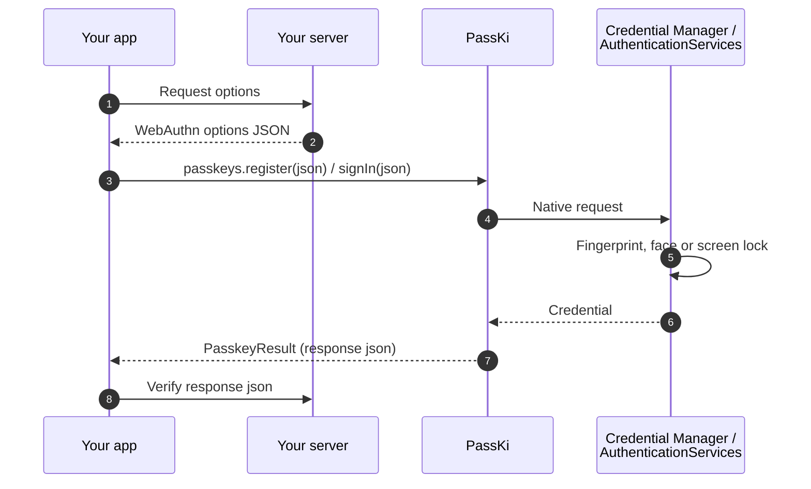
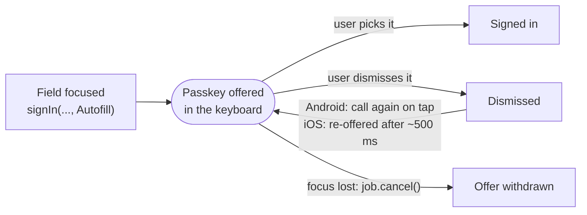
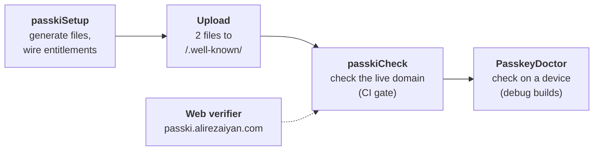

<h1 align="center">PassKi</h1>

<p align="center">
  <b>Passkeys for Kotlin Multiplatform.</b><br>
  One dependency, one call, native authenticators, and errors that tell you how to fix them.
</p>

<p align="center">
  
  
  
  
  
</p>

<table align="center">
  <tr>
    <th>Android 16 · Google Password Manager</th>
    <th>iOS 26.3 · Face ID</th>
  </tr>
  <tr>
    <td></td>
    <td></td>
  </tr>
</table>

<p align="center"><sub>
  The <a href="#sample-app">sample app</a>: <b>Create an account</b> makes a passkey, the demo server checks the
  response (<b>Verified by the server</b>), then <b>Sign in with a passkey</b> after signing out. On Android the
  screen-lock PIN screen is cut out because the system hides it from screen recording, and the Google account address
  is blurred.
</sub></p>

---

**Contents:**
[Why PassKi](#why-passki) ·
[How it works](#how-it-works) ·
[Platforms](#platforms) ·
[Install](#install) ·
[Quick start](#quick-start) ·
[Try it without a server](#try-it-without-a-server) ·
[Compose](#compose) ·
[Autofill](#autofill-sign-in) ·
[PRF and largeBlob](#prf-and-largeblob) ·
[Testing](#test-without-devices) ·
[Setup tooling](#setup-in-5-minutes) ·
[Sample app](#sample-app) ·
[Good to know](#good-to-know)

## Why PassKi

- **One API for Android and iOS.** `register`, `signIn`, `signInOrPassword`, `upgrade` and `signals` from
  `commonMain`. No `Activity`, no `UIWindow`.
- **Errors you can act on.** Every failure is a typed `PasskeyError`. Setup problems come back as
  `PasskeyError.Misconfigured` with a `fixHint` that says exactly what is wrong.
- **Setup that checks itself.** A Gradle plugin writes your `.well-known` files and entitlements, then checks the
  live domain. `PasskeyDoctor` runs the same checks on a device.
- **Compose-ready.** `PasskeySignInButton` and `PasskeyUsernameField`, which offers passkeys in the keyboard.
- **Testable without a device.** `FakePasskeys` returns real ES256 responses that server libraries accept.

## How it works

PassKi sits between your app and the platform authenticator. Your server creates the WebAuthn options and verifies
the result. PassKi never sees your server and keeps no state.



## Platforms

| Platform | What works |
|---|---|
| **Android 9+** (Credential Manager) | register, sign in, passkey-or-password, upgrade, signals, autofill (Android 15+), PRF / largeBlob (depends on the credential provider) |
| **iOS 16+** (AuthenticationServices) | register, sign in, passkey-or-password, autofill, upgrade (iOS 18+), signals (iOS 26+), PRF (iOS 18+), largeBlob (iOS 17+) |
| **JVM desktop, browser** (js / wasmJs) | Compiles, and every call returns `PasskeyError.NotSupported` for now. Native macOS/tvOS/watchOS/Linux/Windows targets are not published yet |

`passkeys.capabilities()` reports what the current device supports, so your UI can adapt before it shows a button.

<details>
<summary><b>Capability flags and extensions per OS version</b></summary>

| `PasskeyCapabilities` | Android | iOS | Notes |
|---|---|---|---|
| `isSupported` | 9+ (API 28) | 16+ | When false, every call fails with `NotSupported` |
| `immediateSignIn` (`SignInMode.ImmediateOnly`) | 9+ | 16+ | |
| `unifiedPasswordSignIn` (`signInOrPassword`) | 9+ | 16+ | |
| `conditionalCreate` (`upgrade`) | 9+ | 18+ | Android: the credential provider may still decline |
| `signals` | 9+ | 26+ | Android: the credential provider may still decline |
| `autofill` (`SignInMode.Autofill`) | 15+ (API 35) | 16+ | Needs a focused username field |

Extensions have no flag. As in browsers, an extension the platform can't handle is ignored and its output is `null`.

| Extension | Android | iOS |
|---|---|---|
| PRF | passed to the credential provider (Google Password Manager supports it) | 18+ |
| largeBlob | passed to the credential provider | 17+ |

</details>

## Install

```kotlin
commonMain.dependencies {
    implementation("com.alirezaiyan.passki:passki:0.1.0-alpha02")
    implementation("com.alirezaiyan.passki:passki-compose:0.1.0-alpha02") // optional, Compose Multiplatform UI helpers
}
commonTest.dependencies { implementation("com.alirezaiyan.passki:passki-test:0.1.0-alpha02") }
```

`passki-demo` (the [demo server](#try-it-without-a-server) client) is optional too, for trying PassKi before you
have a server.

PassKi initialises itself through `androidx.startup`. If your app removes that initializer, call
`PasskiAndroid.init(application)` in `Application.onCreate()`.

Your app and domain also need to trust each other (`assetlinks.json` and Associated Domains). The
[Gradle plugin](#setup-in-5-minutes) generates and checks those files for you.

## Quick start

```kotlin
val passkeys = Passkeys() // no Activity, no UIWindow

passkeys.register(api.registrationOptions())
    .onSuccess { api.finishRegistration(it.json) }
    .onFailure { error ->
        when (error) {
            PasskeyError.Cancelled -> Unit
            is PasskeyError.Misconfigured -> log(error.fixHint) // tells you exactly what's wrong
            else -> showError(error.message)
        }
    }

passkeys.signIn(api.authenticationOptions()).onSuccess { api.finishSignIn(it.json) }
```

The options are your server's WebAuthn JSON, used as-is (a `{"publicKey": ...}` envelope is fine). Verify the
returned `json` on your server with java-webauthn-server, webauthn4j, SimpleWebAuthn or py_webauthn.

| Call | What it does |
|---|---|
| `register(options)` | Creates a passkey |
| `signIn(options, mode)` | Signs in. `mode` is `Modal` (default), `ImmediateOnly` (only passkeys already on this device; fails fast with `NoCredentials` otherwise) or `Autofill` |
| `signInOrPassword(options)` | One sheet with passkeys and saved passwords |
| `upgrade(options)` | Adds a passkey without UI after a password sign-in, if the platform agrees ([details](#good-to-know)) |
| `signals.unknownCredential(rpId, credentialId)` | Tells the password manager a passkey was deleted on the server. Also `acceptedCredentials` and `currentUserDetails` |
| `capabilities()` | What this device supports |

```kotlin
val caps = passkeys.capabilities()
if (caps.unifiedPasswordSignIn) { /* offer the combined passkey + password button */ }
```

## Try it without a server

Passkeys need a domain that trusts your app and a server that verifies responses. To try PassKi in your own app
first, use the hosted demo relying party at [passki.alirezaiyan.com](https://passki.alirezaiyan.com). It creates real
challenges and verifies every response with SimpleWebAuthn. **For evaluation only:** demo users expire after 24 hours.

1. Add the demo client next to `passki`:

   ```kotlin
   commonMain.dependencies { implementation("com.alirezaiyan.passki:passki-demo:0.1.0-alpha02") }
   ```

2. Apply the [Gradle plugin](#gradle-plugin) to your Android app module and point it at the demo server:

   ```kotlin
   passki {
       useDemoServer() // instead of rpId = "..."
   }
   ```

3. Run `./gradlew passkiSetup`. It adds `webcredentials:passki.alirezaiyan.com` to your iOS entitlements and
   registers your app with the demo server for 7 days. It prints exactly what it sends (package names, signing SHA-256
   fingerprints, `TEAM.bundle` IDs, all public data) and the server's answer. Add `--preview` to see it first without
   sending anything.

4. Call PassKi with the demo server's options, and send the result back for verification:

   ```kotlin
   val demo = PasskiDemoServer()
   passkeys.register(demo.registrationOptions("alice"))
       .onSuccess { println(demo.verifyRegistration(it.json)) } // verified by server ✓ signCount 0 …
   passkeys.signIn(demo.authenticationOptions())
       .onSuccess { println(demo.verifyAuthentication(it.json)) }
   ```

`./gradlew passkiCheck` then checks the whole chain against the demo domain. On Android, Google caches asset links, so
a newly registered app can take a few minutes before passkeys work; check AND-04 shows when Google lists it.

**Going to production:** replace `useDemoServer()` with `rpId = "your.domain"` and `PasskiDemoServer` with your own
API. The PassKi calls stay the same.

## Compose

`passki-compose` turns passkey sign-in into a few lines of Compose Multiplatform code. It has the same targets as
`passki` and exposes it as an `api` dependency.

<table>
<tr>
<td>

```kotlin
@Composable
fun SignInScreen(api: MyApi) {
    val scope = rememberCoroutineScope()
    val passkeys = rememberPasskeys()
    var username by remember { mutableStateOf("") }

    // Offers passkeys as keyboard suggestions
    // while the field is focused.
    PasskeyUsernameField(
        value = username,
        onValueChange = { username = it },
        requestOptions = { api.authenticationOptions() },
        onSignedIn = { assertion ->
            scope.launch { api.finishSignIn(assertion.json) }
        },
        passkeys = passkeys,
    )

    // Material 3 button: shows progress while running,
    // double taps are safe.
    val signIn = rememberPasskeySignIn(
        requestOptions = { api.authenticationOptions() },
        passkeys = passkeys,
    )
    PasskeySignInButton(
        state = signIn,
        onSignedIn = { assertion ->
            scope.launch { api.finishSignIn(assertion.json) }
        },
        onError = { error -> showError(error.message) }, // never Cancelled
    )
}
```

</td>
<td width="260">

<p align="center"><sub><code>PasskeyUsernameField</code> and <code>PasskeySignInButton</code> in the sample app on Android 16: saved passkeys show up as suggestions above the keyboard.</sub></p>
</td>
</tr>
</table>

For custom UI, use the headless state from `rememberPasskeySignIn(requestOptions, passkeys, mode)`. `isRunning` and
`lastError` are Compose state, and `signIn()` returns a `PasskeyResult<PasskeyAssertion>`:

```kotlin
val state = rememberPasskeySignIn(
    requestOptions = { api.authenticationOptions() },
    mode = SignInMode.ImmediateOnly,
)
Button(enabled = !state.isRunning, onClick = {
    scope.launch { state.signIn().onSuccess { api.finishSignIn(it.json) } }
}) { Text("Sign in") }
state.lastError?.let { Text(it.message) } // Cancelled is never stored
```

- A `signIn()` call made while another one is running joins it instead of opening a second sheet.
- If `requestOptions` throws, the exception comes back as `PasskeyError.Unknown` with the exception as its `cause`.
- Every helper takes an optional `passkeys` parameter, so you can pass `FakePasskeys` in previews and tests.
- Parameters follow the Compose convention: required ones first, then `modifier` (for UI), then optional ones with
  defaults, `passkeys` first.

<details>
<summary><b>PasskeyUsernameField in detail</b></summary>

`PasskeyUsernameField(value, onValueChange, requestOptions, onSignedIn, modifier, passkeys, label, onError, enabled)`
keeps a `SignInMode.Autofill` request open while it is focused and `capabilities().autofill` is true. It withdraws the
offer when it loses focus or leaves composition. Typing works as usual, so the same field also serves your password
or "continue with username" path.

- **Android 15+:** a Material 3 `OutlinedTextField` marked as a username field. The passkey shows up as a suggestion
  chip in the keyboard; tapping it opens the credential provider's sheet. It also works inside a `Dialog` or
  `ModalBottomSheet`.
- **iOS 16+:** the field hosts a UIKit `UITextField` with `textContentType = .username`, drawn with a Material-like
  border and label. A Compose text field with `ContentType.Username` does not make iOS offer passkeys (checked on iOS
  26.3), so the UIKit field is required. iOS shows a **"Passwords"** item in the QuickType bar rather than the account
  name. Tapping it (after Face ID) opens a list that includes your passkeys. In the simulator, turn off the hardware
  keyboard (I/O > Keyboard, or ⌘K) to see the QuickType bar.
- **JVM desktop and browser:** a plain text field. No request is made.

`onError` only reports problems autofill can't recover from: `NotSupported`, `Misconfigured` or `InvalidOptions`.
These are reported once, and then the field stops offering passkeys. It also reports unexpected errors such as
`requestOptions` throwing; the field then tries again on the next focus or tap. Dismissing the suggestion is never
reported.

</details>

## Autofill sign-in

`SignInMode.Autofill` (WebAuthn "conditional mediation") offers passkeys in the keyboard or QuickType bar of the
focused username field. It needs Android 15 (API 35)+ or iOS 16+ (`capabilities().autofill`).
`PasskeyUsernameField` does all of this for you. To use it with your own field:

```kotlin
// Your username field must be focused (content type username) when you call this.
val job = scope.launch {
    passkeys.signIn(api.authenticationOptions(), SignInMode.Autofill)
        .onSuccess { api.finishSignIn(it.json) }
}
// When the field loses focus or leaves the screen:
job.cancel() // withdraws the offer
```



- **The call suspends until the user picks a passkey.** Dismissing the suggestion or the sheet does not complete it.
  Cancel the coroutine to withdraw the offer.
- **Re-arming after a dismissal:** on Android the chip does not come back while the field stays focused, so cancel and
  call again, for example when the field is tapped (`PasskeyUsernameField` re-arms on every tap). On iOS, PassKi
  offers the passkeys again by itself, about 500 ms after a dismissal.
- **Stale chips (Android):** a chip that has been visible for more than about a minute can fail in Google Password
  Manager with "Flow has timed out". The next call offers a fresh one.
- **Errors:** below Android 15, `NotSupported`. On Android with no focused view, `Misconfigured` ("Autofill needs a
  focused text field"). On iOS, a missing association gives `Misconfigured`, as with the other calls.

## PRF and largeBlob

`PasskeyExtensions` adds typed WebAuthn extensions to the options JSON from your server. Use it when the inputs come
from the device, for example a PRF salt for client-side encryption that the server must never see. Each helper
returns new JSON, keeps other extensions and a `{"publicKey": ...}` envelope, and throws `IllegalArgumentException`
for the wrong kind of options.

```kotlin
// PRF: the same passkey and salt always give the same 32 bytes, so they can derive an encryption key.
val options = PasskeyExtensions.withPrf(api.authenticationOptions(), first = salt) // optional second = salt2
passkeys.signIn(options).onSuccess { assertion ->
    val key = assertion.prf?.first // null if PRF is not supported here
}

// At registration: ask whether the new passkey supports PRF.
passkeys.register(PasskeyExtensions.withPrf(api.registrationOptions()))
    .onSuccess { println(it.prfEnabled) } // true / false / null (not answered)

// largeBlob: create with storage, then read or write while signing in.
passkeys.register(PasskeyExtensions.withLargeBlob(creationOptions, LargeBlobSupport.Preferred))  // .largeBlobSupported
passkeys.signIn(PasskeyExtensions.withLargeBlobWrite(requestOptions, blob))                         // .largeBlobWritten
passkeys.signIn(PasskeyExtensions.withLargeBlobRead(requestOptions))                                // .largeBlob
```

| Output | On |
|---|---|
| `prf: PrfResults?` (`first`, `second`) | `PasskeyAssertion`; `PasskeyRegistration` when the provider evaluates PRF at registration |
| `prfEnabled: Boolean?` | `PasskeyRegistration` |
| `largeBlobSupported: Boolean?` | `PasskeyRegistration` |
| `largeBlob: ByteArray?` / `largeBlobWritten: Boolean?` | `PasskeyAssertion` |

The outputs are also in the response `json` (`clientExtensionResults`) for your server. PRF results and blobs are
secrets: `PrfResults.toString()` prints only their sizes.

<details>
<summary><b>Platform notes</b></summary>

- **Android:** the options pass through to the credential provider unchanged. Support depends on the provider; Google
  Password Manager returns PRF results.
- **iOS:** PassKi maps the extensions to the AuthenticationServices PRF and largeBlob inputs. Below iOS 18 (PRF) or
  iOS 17 (largeBlob) the extension is left out silently and its output is `null`, as in browsers. Without salts at
  registration, iOS only reports `prfEnabled`.
- **largeBlob writes** need the passkey named in `allowCredentials`. Read and write are exclusive:
  `withLargeBlobWrite` replaces a `withLargeBlobRead` request.
- **`FakePasskeys`** computes PRF deterministically (HMAC-SHA256 of a per-credential secret and the salt) and stores
  large blobs, so you can test PRF-derived keys without a device. Don't use it as a real key source.

</details>

## Test without devices

```kotlin
val passkeys = FakePasskeys(origin = "https://example.com") // real ES256 responses, accepted by webauthn4j
passkeys.failNextWith(PasskeyError.Cancelled)               // next call fails once
passkeys.conditionalCreate = false                          // simulate a device without conditional create
```

- Other capability flags: `isSupported`, `immediateSignIn`, `unifiedPasswordSignIn`, `signalsSupported`,
  `autofillSupported` (when on, `SignInMode.Autofill` completes at once, as if the user picked the suggestion).
- `passkeys.authenticator.prfSupported` / `largeBlobSupported` switch the extensions off.
- `TestOptions.creation(rpId)` and `TestOptions.request(rpId)` build server-style options JSON.

## Setup in 5 minutes

Most passkey failures are configuration: a missing fingerprint, a wrong Team ID, a redirecting `.well-known` file.
PassKi checks these in three places, and all three use the same check IDs from the
[check catalog](docs/checks/README.md):



With the [Gradle plugin](#gradle-plugin) applied to your Android app module:

1. **Generate and wire everything:** `./gradlew passkiSetup` (add `--preview` to see every change first)
2. **Upload two files** from `build/passki/well-known/` to `https://<rpId>/.well-known/` (HTTP 200, no redirects).
3. **Check it end to end:** `./gradlew passkiCheck`

`passkiSetup` writes `assetlinks.json` and `apple-app-site-association`, and adds `webcredentials:<rpId>` to your iOS
entitlements. It wires them into Xcode through `Configuration/Config.xcconfig` (`CODE_SIGN_ENTITLEMENTS`; it never
edits `project.pbxproj`). It also writes your server's RP ID and origins to `build/passki/server-config.json`, plus
snippets for SimpleWebAuthn, webauthn4j, java-webauthn-server and py_webauthn. It is safe to re-run.

It ends with a summary of every file it created, changed or left unchanged, with a diff for your own files
(entitlements, `xcconfig`), then the next steps. `--preview` prints the same summary and writes nothing:

```
$ ./gradlew passkiSetup --preview
passki setup summary (preview: nothing was written or sent)
  would create  androidApp/build/passki/well-known/assetlinks.json
  would change  iosApp/iosApp/iosApp.entitlements
      + 		<string>webcredentials:example.com</string>
  would change  iosApp/Configuration/Config.xcconfig
      + CODE_SIGN_ENTITLEMENTS = iosApp/iosApp.entitlements
  ...
next steps
  1. Upload androidApp/build/passki/well-known/assetlinks.json and ... to https://example.com/.well-known/ ...
```

`passkiCheck` prints one line per check (`[PASS] AND-01 ...`, with a `fix:` line under each problem) and writes an
HTML report. This is the report for the sample app:

<p align="center">
  
</p>

- Every check has a docs page: `docs/checks/<ID>.md`.
- The report is written to `build/reports/passki/check.json` and `index.html`.
- `passkiCheck` exits non-zero on any failure, so it works as a CI gate. Add
  `-Ppasski.check.warningsAsErrors=true` to fail on warnings too.
- Without Xcode (Linux CI) the Xcode checks are skipped.

### Gradle plugin

Apply it in your Android application module (`com.android.application`). Without one (an iOS-only app), apply it
anywhere: `passkiSetup` and `passkiCheck` then run in iOS-only mode and say so. Applied to a module that isn't the
Android app (such as `shared`), they also run in iOS-only mode and name the module to apply it to instead.

```kotlin
plugins {
    id("com.android.application")
    id("com.alirezaiyan.passki") version "0.1.0-alpha02"
}

passki {
    rpId = "example.com"
    apple {
        teamId = "ABCDE12345"
        bundleId = "com.example.app"
    }
}
```

<details>
<summary><b>All options</b></summary>

```kotlin
passki {
    rpId = "example.com" // a bare domain: checked when a task runs, with the corrected value if it isn't
    android {
        // Fingerprints you can't derive from a local keystore, e.g. Play App Signing (colon-hex SHA-256).
        extraFingerprints.add("AB:CD:...")
    }
    apple {
        teamId = "ABCDE12345"
        bundleId = "com.example.app"
        entitlementsFile = rootProject.file("iosApp/iosApp/iosApp.entitlements") // optional
        // All optional; discovered from the KMP template layout when unset:
        // xcodeProject = rootProject.file("iosApp/iosApp.xcodeproj"); scheme = "iosApp"
        // xcconfig = rootProject.file("iosApp/Configuration/Config.xcconfig"); developerMode = true
    }
    server {
        // Optional, for passkiCheck SRV-01..03: GET returns {"rpId": "...", "origins": [...]} or registration options.
        configUrl = "https://example.com/passki/server-config"
    }
}
```

The Android package and signing fingerprints are read from your Android build; `android { packageName = "..." }`
overrides the base application ID. `assetlinks.json` gets one statement per package the build produces, so a build
type with `applicationIdSuffix = ".debug"` gets its own `com.example.app.debug` statement with only the debug key.
`extraFingerprints` go to the packages of non-debuggable variants.

</details>

| Task | What it does |
|---|---|
| `passkiSetup` | Writes the well-known files, iOS entitlements and their `xcconfig` wiring, `server-config.json` and verifier snippets (with `useDemoServer()`: registers the app with the demo server instead of writing well-known files and server config); ends with a summary and next steps. `--preview` changes nothing. `teamId`/`bundleId` default to `xcodebuild -showBuildSettings` |
| `passkiCheck` | Runs the catalog checks AND-01..05, IOS-01..06 and SRV-01..03 and writes `build/reports/passki/`. Needs network and is not part of `check` |
| `passkiFingerprints` | Prints package, variant, keystore and SHA-256 per variant, plus the `android:apk-key-hash:` origins for your server allow-list |

Two more tasks are listed under "passki advanced" in `./gradlew tasks --all` and are kept for existing scripts:
`passkiWellKnown` (only the well-known files of `passkiSetup`) and `passkiVerify` (only the hosted-file checks of
`passkiCheck`, without a report).

```
$ ./gradlew passkiFingerprints
passki signing fingerprints:
  package                | variant | keystore                         | SHA-256
  com.alirezaiyan.passki | debug   | .../androidApp/sample-debug.keystore | 59:E5:92:32:...:57:88:E2:06:C0
  com.alirezaiyan.passki | release | -                                | (no signing config)
Android WebAuthn origins (server allow-list):
  android:apk-key-hash:WeWSMk5s5vpf4vCKORgTLaUd3l35vRHwXOgjV4jiBsA
```

> [!WARNING]
> Keystore passwords are read from your signing configs but are not tracked task inputs (up-to-date checks use the
> keystore file, alias and type). They are stored in the configuration-cache entry under
> `.gradle/configuration-cache/`, which stays on your machine: don't share or upload that directory.

### PasskeyDoctor

`PasskeyDoctor` runs the same checks on the device: platform support, screen lock, PassKi initialisation, the
`INTERNET` permission, your hosted `assetlinks.json` (Android) or `apple-app-site-association` (iOS), and the origin
your server must allow.

<table>
<tr>
<td>

```kotlin
if (BuildConfig.DEBUG) {
    // suspend; bare domain, never throws for setup problems
    val report = PasskeyDoctor.run("example.com")
    println(report)
    // passkeys won't work until these are fixed
    report.failures.forEach { log(it.message, it.fixHint) }
    // likely trouble, not blocking
    report.warnings.forEach { log(it.message, it.fixHint) }
}
```

- **Debug builds only.** It makes network requests and never runs
  automatically.
- On platforms other than Android and iOS the report holds a single
  skipped check.
- A failing check prints a `fix:` line under it. The text is for
  humans; read `report.checks` (`id`, `name`, `status`, `message`,
  `fixHint`) instead of parsing it.

</td>
<td width="260">

<p align="center"><sub>The sample app's <b>Setup</b> tab: <code>PasskeyDoctor</code> plus the server checks, each with its catalog ID.</sub></p>
</td>
</tr>
</table>

### Web dashboard and demo server

[passki.alirezaiyan.com](https://passki.alirezaiyan.com) is a hosted relying party with a setup dashboard, built on
SimpleWebAuthn. Its source is in `passki-web/`. Type your domain on the home page and it draws the trust link between
your Android app, your domain and your iOS app, turning each check green as it passes:

<p align="center">
  <a href="https://passki.alirezaiyan.com"></a>
</p>

- **Verifier:** enter your RP ID, and optionally your package, fingerprints, Team ID and bundle ID. The server fetches
  your `assetlinks.json` and `apple-app-site-association`, asks Google Digital Asset Links and the Apple CDN, and runs
  the same catalog checks (same IDs and fixes) as `passkiCheck`, grouped by platform. It re-checks every 10 s while
  you deploy, and can create a read-only report link that expires after 7 days. Optionally it checks your server's
  options endpoint (SRV checks).

  <details>
  <summary>Screenshot</summary>

  <p align="center">
    
  </p>

  </details>

- **Generator:** enter the RP ID, packages, SHA-256 fingerprints, Team ID and bundle ID, and get both well-known files,
  the entitlements and `xcconfig` lines and the server origin allow-list, as a zip.
- **Check docs:** one page per check ID, the same pages as [`docs/checks/`](docs/checks/README.md).
- **Self-service iOS demo:** your Team ID differs from ours, so register your `TEAM.bundle` app ID on the demo page.
  It is listed in the demo `apple-app-site-association` for 7 days. Use it with
  `webcredentials:passki.alirezaiyan.com?mode=developer`. Registration is rate-limited per IP.
- **Demo RP API:** `/api/demo/register/options|verify`, `/api/demo/login/options|verify` and
  `/api/demo/server-config`. Challenges are real and single-use, and each response gets a server verdict. Demo users
  expire after 24 hours.

The server fetches only `https://<domain>/.well-known/…` and the fixed Google and Apple endpoints. It blocks IP
literals and private or reserved addresses, pins the validated DNS answer, never follows redirects, and caps the time
and size of every fetch.

### Server setup by hand

If you don't use the Gradle plugin:

- **Android:** serve `https://<rpId>/.well-known/assetlinks.json` with `delegate_permission/common.get_login_creds`
  and your signing SHA-256. Allow the origin `android:apk-key-hash:<base64url-sha256>` in your verifier.
- **iOS:** add the Associated Domains `webcredentials:<rpId>` entitlement and serve
  `/.well-known/apple-app-site-association`.
- See [`docs/setup/well-known/`](docs/setup/well-known/README.md) for templates.

## Sample app

`androidApp`, `iosApp` and `shared/` make up the Compose Multiplatform sample shown at the top. It runs every PassKi
call against the demo relying party, and the server verifies every response. It has three tabs:

<table>
  <tr>
    <th>Demo</th>
    <th>Lab</th>
    <th>Setup</th>
  </tr>
  <tr>
    <td></td>
    <td></td>
    <td></td>
  </tr>
  <tr>
    <td valign="top"><sub>A real sign-in screen built with <code>PasskeyUsernameField</code> and <code>PasskeySignInButton</code>. After a sign-in it shows what the server checked: credential, sign count, user verification, backup state, origin and AAGUID.</sub></td>
    <td valign="top"><sub>Every other flow, one tap each: device-only sign-in, passkey or password, autofill in a dialog, register with PRF, upgrade, PRF key derivation and signals, with a result per row and an activity log.</sub></td>
    <td valign="top"><sub><b>Run setup check</b> runs <code>PasskeyDoctor</code> and the server checks SRV-01/02 as a checklist with catalog IDs, plus what this device supports.</sub></td>
  </tr>
</table>

- **Android, zero config:** the debug build is signed with the committed `androidApp/sample-debug.keystore`, whose
  fingerprint the demo `assetlinks.json` lists. See [`androidApp/README.md`](androidApp/README.md).

  > [!CAUTION]
  > That key is public. Never use it for a release or for your own app.

- **iOS:** register your Team ID on the demo page (see above), then set `TEAM_ID` and `PRODUCT_BUNDLE_IDENTIFIER` in
  `iosApp/Configuration/Config.xcconfig`. The entitlements are wired through that file.
- **Unattended smoke run:** start the app with an autorun flag. It runs the UI-free steps first (capabilities, Setup
  check, server options, device-only sign-in with an unknown credential, signals, upgrade), then the interactive ones,
  and logs `PASSKI_DEMO` lines.
  - Android: `adb shell am start -n com.alirezaiyan.passki/.MainActivity --ez passkiAutorun true`, then read
    `adb logcat -s System.out`.
  - iOS: `xcrun simctl launch --console <device> com.alirezaiyan.passki.PassKi -passkiAutorun`.

## Good to know

- **`upgrade()` is opportunistic.** It uses conditional create, so the platform may decline without any UI. A decline
  is reported as `PasskeyError.NotSupported` on both platforms (Android: the credential provider rejected conditional
  create; iOS: the system declined, typically because there was no recent password AutoFill sign-in for the
  account). Treat every `upgrade()` failure as silent: do not show an error and do not block your login flow.
- **Verifying upgrade responses.** A conditional-create response is created without a user prompt, so the
  user-presence (UP) flag may be 0. Servers verifying these responses must not require user presence.
- **`excludeCredentials` on iOS < 17.4 is ignored** by the system, so a duplicate passkey may be created; dedupe on
  your server. `PasskeyError.AlreadyRegistered` is guaranteed on Android and iOS 17.4+.
- **Duplicate registration on Android shows a sheet first.** When `excludeCredentials` matches, Google Password
  Manager still shows its create sheet; `PasskeyError.AlreadyRegistered` is returned only after the user taps
  Continue.
- **Android `upgrade()` and `signals` depend on the user's credential provider** and may return
  `PasskeyError.NotSupported` even when `capabilities()` reports them as available.
- **iOS registration responses** omit the WebAuthn Level 3 `publicKey` and `publicKeyAlgorithm` fields. Read the
  public key from `attestationObject`, which every server library already does.
- **Signals on iOS** work on iOS 26+ through `ASCredentialUpdater`. That API is Swift-only, so PassKi ships a small
  Swift bridge compiled into its klib. Your app needs **no setup**: no Swift file, no linker flags, and PassKi links
  as a static or a dynamic framework. Older iOS versions return `PasskeyError.NotSupported`; the iOS 26 symbols are
  weak-linked, so the app still runs there. iOS takes only one name, so `currentUserDetails` reports `name` and
  ignores `displayName`. The updater refuses signals for a domain the app is not associated with; PassKi reports
  that as `PasskeyError.Misconfigured` with an AASA hint.

## Verified on

Both runs used the sample app against the demo relying party, and the server verified every response. A
registration and assertion pair from each run is a fixture in `passki-test`, verified against its public key.

<details>
<summary><b>Android 16 emulator (API 36, Google Password Manager)</b></summary>

- register
- sign in (modal, `PasskeySignInButton`), device-only sign-in and passkey-or-password
- autofill: the passkey chip in Gboard, re-armed by a tap after a dismissal
- PRF: 32 bytes, the same output for the same salt on two runs
- signals: after `unknownCredential`, device-only sign-in returns `NoCredentials`; `currentUserDetails` renamed the
  passkey in the GPM chip
- upgrade: declined by the provider and reported as `NotSupported`, as expected
- Setup check: doctor 0 failures, SRV-01/02 pass

</details>

<details>
<summary><b>iOS 26.3 simulator (Face ID)</b></summary>

- register (the response was shared as an `ios` fixture on the demo RP)
- sign in (modal, `PasskeySignInButton`), device-only sign-in and passkey-or-password
- autofill through `PasskeyUsernameField`: "Passwords" in the QuickType bar, then Face ID, then the passkey list,
  then signed in
- PRF: 32 bytes, the same output for the same salt on two runs
- cancel: closing the sheet returns `Cancelled`
- signals: after `unknownCredential`, device-only sign-in returns `NoCredentials` (the passkey is gone);
  `currentUserDetails` renamed the passkey in the system sheet
- Setup check: doctor 0 failures (IOS-03 AASA pass, IOS-04 skipped at runtime), SRV-01/02 pass
- build, plus `passkiCheck` IOS-04/05/06; `-passkiAutorun` declines upgrade as expected

**Not verified on iOS:** `AlreadyRegistered`. The demo relying party creates a new user for every registration and
sends no `excludeCredentials`, so the sample cannot trigger it; it is covered by unit tests only (error 1006). On an
iOS 17.5 simulator, signals return `NotSupported` as designed.

</details>

Earlier real registration responses from both platforms were verified with webauthn4j; the fixtures live in
`passki-test`.

## API docs

Generate the API reference with `./gradlew dokkaGenerate` (`passki`, `passki-compose` and `passki-test`, aggregated
into `build/dokka/html/`, or per module with `:passki:dokkaGenerate`).

## Contributing

See [CONTRIBUTING.md](CONTRIBUTING.md). Building the iOS targets needs Xcode (the Swift bridge for the Signal API is
compiled with `xcrun swiftc`).

## License

Apache-2.0 © Ali Rezaiyan
