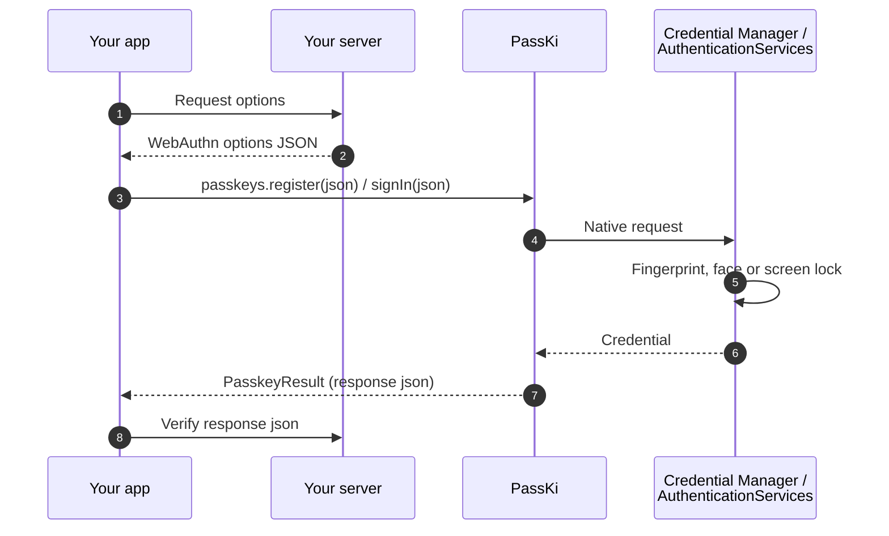
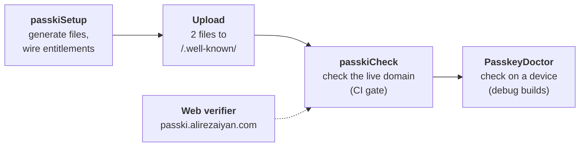

<h1 align="center">PassKi</h1>

<p align="center">
  <b>Passkeys for Kotlin Multiplatform.</b><br>
  One dependency, one call, native authenticators, and errors that tell you how to fix them.
</p>

<p align="center">
  
  
  
  
  
</p>

<table align="center">
  <tr>
    <th>Android 16 · Google Password Manager</th>
    <th>iOS 26.3 · Face ID</th>
  </tr>
  <tr>
    <td></td>
    <td></td>
  </tr>
</table>

<p align="center"><sub>
  The <a href="#sample-app">sample app</a>: <b>Create an account</b> makes a passkey, the demo server checks the
  response (<b>Verified by the server</b>), then <b>Sign in with a passkey</b> after signing out. On Android the
  screen-lock PIN screen is cut out because the system hides it from screen recording, and the Google account address
  is blurred.
</sub></p>

---

**Contents:**
[Get started](#get-started) ·
[Why PassKi](#why-passki) ·
[How it works](#how-it-works) ·
[Install](#install) ·
[Quick start](#quick-start) ·
[Platforms](#platforms) ·
[Compose](#compose) ·
[Testing](#test-without-devices) ·
[Setup](#setup) ·
[Sample app](#sample-app) ·
[Good to know](#good-to-know) ·
[More docs](#more-docs)

## Get started

Pick the path that matches what you want to know:

| Path | Answers | Takes |
|---|---|---|
| [A. Run the sample](#a-run-the-sample) | Does PassKi work? | Android: run it. iOS: one Team ID |
| [B. Try it in your app](#b-try-it-in-your-app) | Does it work in *my* app? | No domain, no server |
| [C. Ship it](#c-ship-it) | How do I set up my own domain and server? | One command, two uploaded files, one check |

B and C use the same Gradle tasks and the same checks; only the relying party changes. Every task prints what it
changes and sends, and `--preview` shows it before anything happens.

### A. Run the sample

1. Clone this repository and open it in Android Studio.
2. **Android:** run `androidApp`. Its debug key is already listed on the demo server, so there is nothing to set up.
3. **iOS:** copy `iosApp/Configuration/Local.xcconfig.example` to `Local.xcconfig` (git ignores it) and set your
   `TEAM_ID`.
4. **iOS:** run `./gradlew passkiSetup` (it registers your iOS app with the demo server), then run `iosApp` from Xcode.

The app runs a setup check at launch and shows a banner with the failing check IDs if anything is wrong. Details:
[Sample app](#sample-app).

### B. Try it in your app

The hosted demo relying party at [passki.alirezaiyan.com](https://passki.alirezaiyan.com) creates real challenges and
verifies every response with SimpleWebAuthn. **For evaluation only:** demo users expire after 24 hours.

1. Add `passki` and the demo client (see [Install](#install) for the repositories):

   ```kotlin
   commonMain.dependencies {
       implementation("com.alirezaiyan.passki:passki:0.1.0-alpha02")
       implementation("com.alirezaiyan.passki:passki-demo:0.1.0-alpha02")
   }
   ```

2. Apply the [Gradle plugin](docs/setup.md#gradle-plugin) to your Android app module and point it at the demo server:

   ```kotlin
   passki {
       useDemoServer() // instead of rpId = "..."
   }
   ```

3. Run `./gradlew passkiSetup`. It adds `webcredentials:passki.alirezaiyan.com` to your iOS entitlements and
   registers your app with the demo server for 7 days. It prints exactly what it sends (package names, signing SHA-256
   fingerprints, `TEAM.bundle` IDs, all public data) and the server's answer. Add `--preview` to see it first without
   sending anything.

4. Call PassKi with the demo server's options, and send the result back for verification:

   ```kotlin
   val demo = PasskiDemoServer()
   passkeys.register(demo.registrationOptions("alice"))
       .onSuccess { println(demo.verifyRegistration(it.json)) } // verified by server ✓ signCount 0 …
   passkeys.signIn(demo.authenticationOptions())
       .onSuccess { println(demo.verifyAuthentication(it.json)) }
   ```

`./gradlew passkiCheck` then checks the whole chain against the demo domain. On Android, Google caches asset links, so
a newly registered app can take a few minutes before passkeys work; check AND-04 shows when Google lists it.

### C. Ship it

1. [Install](#install) `passki` and implement the four calls of your server API ([Quick start](#quick-start)).
2. Apply the [Gradle plugin](docs/setup.md#gradle-plugin) with `passki { rpId = "example.com" }` and run
   `./gradlew passkiSetup` (`--preview` first, if you like).
3. Upload the two files it lists to `https://example.com/.well-known/`, and configure your server with the RP ID and
   origins it prints (ready-made snippets for SimpleWebAuthn, webauthn4j, java-webauthn-server and py_webauthn are in
   `build/passki/server-snippets/`).
4. Run `./gradlew passkiCheck`. It checks the live domain, your Xcode wiring and your server, and fails on problems, so
   it also works as a CI gate.

Coming from path B: replace `useDemoServer()` with `rpId = "your.domain"` and `PasskiDemoServer` with your own API.
The PassKi calls stay the same.

## Why PassKi

- **One API for Android and iOS.** `register`, `signIn`, `signInOrPassword`, `upgrade` and `signals` from
  `commonMain`. No `Activity`, no `UIWindow`.
- **Errors you can act on.** Every failure is a typed `PasskeyError`. Setup problems come back as
  `PasskeyError.Misconfigured` with a `fixHint` that says exactly what is wrong, and a `checkId` (such as `AND-03`)
  that `PasskeyDoctor`, `passkiCheck` and the web verifier use for the same problem.
- **Setup that checks itself.** A Gradle plugin writes your `.well-known` files and entitlements, then checks the
  live domain. `PasskeyDoctor` runs the same checks on a device.
- **Compose-ready.** `PasskeySignInButton` and `PasskeyUsernameField`, which offers passkeys in the keyboard.
- **Testable without a device.** `FakePasskeys` returns real ES256 responses that server libraries accept.

## How it works

PassKi sits between your app and the platform authenticator. Your server creates the WebAuthn options and verifies
the result. PassKi never sees your server and keeps no state.



## Install

> [!IMPORTANT]
> `0.1.0-alpha02` is not on Maven Central yet. Until it is, publish it to your local Maven repository and add
> `mavenLocal()` to `repositories` (and to `pluginManagement.repositories` for the Gradle plugin):
>
> ```sh
> git clone https://github.com/rezaiyan/PassKi && cd PassKi
> ./gradlew :passki:publishToMavenLocal :passki-compose:publishToMavenLocal :passki-test:publishToMavenLocal :passki-demo:publishToMavenLocal
> ./gradlew -p passki-gradle-plugin publishToMavenLocal
> ```

```kotlin
commonMain.dependencies {
    implementation("com.alirezaiyan.passki:passki:0.1.0-alpha02")
    implementation("com.alirezaiyan.passki:passki-compose:0.1.0-alpha02") // optional, Compose Multiplatform UI helpers
    implementation("com.alirezaiyan.passki:passki-demo:0.1.0-alpha02")    // optional, the demo server client (path B)
}
commonTest.dependencies { implementation("com.alirezaiyan.passki:passki-test:0.1.0-alpha02") }
```

**Requirements:**

| Your app | Needs |
|---|---|
| Android (JVM) | Kotlin 2.1 or newer, `compileSdk` 35 or newer, `minSdk` 24 or newer (passkeys need Android 9, API 28, at runtime). Checked with AGP 9.1.1's built-in Kotlin 2.2.10 and `compileSdk` 35 |
| iOS, JS and Wasm (Kotlin Multiplatform) | Kotlin 2.2 or newer. Checked with Kotlin 2.2.21 and 2.4.20 (iOS simulator and JVM tests of an app using PassKi) |

PassKi is built with Kotlin 2.2.21, publishes Kotlin 2.2 metadata and depends on `kotlin-stdlib` 2.2, so it doesn't push
your app to a newer Kotlin. Its own dependencies are kept at releases built with Kotlin 2.2 for the same reason
(kotlinx-serialization 1.9, Ktor 3.3 in `passki-demo`, Compose Multiplatform 1.10 in `passki-compose`).

PassKi initialises itself through `androidx.startup`. If your app removes that initializer, call
`PasskiAndroid.init(application)` in `Application.onCreate()`.

Your app and domain also need to trust each other (`assetlinks.json` and Associated Domains). The
[Gradle plugin](#setup) generates and checks those files for you.

## Quick start

Your server creates the WebAuthn options and verifies the responses. In your app that is four calls, for example:

```kotlin
interface MyApi {
    suspend fun registrationOptions(): String          // POST /passkeys/register/options → creation options JSON
    suspend fun finishRegistration(responseJson: String)
    suspend fun authenticationOptions(): String        // POST /passkeys/login/options → request options JSON
    suspend fun finishSignIn(responseJson: String)
}
```

```kotlin
val passkeys = Passkeys() // no Activity, no UIWindow

passkeys.register(api.registrationOptions())
    .onSuccess { api.finishRegistration(it.json) }
    .onFailure { error ->
        when (error) {
            PasskeyError.Cancelled -> Unit
            is PasskeyError.Misconfigured -> log("${error.fixHint} ${error.docsUrl}") // what's wrong + its check's docs page
            else -> showError(error.message)
        }
    }

passkeys.signIn(api.authenticationOptions()).onSuccess { api.finishSignIn(it.json) }
```

The options are your server's WebAuthn JSON, used as-is (a `{"publicKey": ...}` envelope is fine). Verify the
returned `json` on your server with java-webauthn-server, webauthn4j, SimpleWebAuthn or py_webauthn.

Setup errors name the [catalog check](docs/checks/README.md) that covers them, so a runtime error, the device doctor
and `passkiCheck` all point to the same docs page:

| Error | `checkId` |
|---|---|
| Android: the RP ID is not associated with the app (asset links) | `AND-03` (the doctor and `passkiCheck` also report `AND-01`/`AND-02` when those fail) |
| Android: no credential provider can create or return the passkey | `DEV-01` |
| Android: PassKi not initialised, or no foreground Activity | `AND-06` |
| iOS: the app is not associated with the domain (AASA or entitlement) | `IOS-02` (`passkiCheck` also covers the entitlement: `IOS-04`..`IOS-06`) |
| Options without an RP ID, or an RP ID that isn't a bare domain (`InvalidOptions`) | `CFG-01` |

`error.docsUrl` links the check's page, and `getOrThrow()`'s exception message includes the fix and the link. Errors
that no setup check covers (for example autofill without a focused field) have no `checkId`.

| Call | What it does |
|---|---|
| `register(options)` | Creates a passkey |
| `signIn(options, mode)` | Signs in. `mode` is `Modal` (default), `ImmediateOnly` (only passkeys already on this device; fails fast with `NoCredentials` otherwise) or `Autofill` |
| `signInOrPassword(options)` | One sheet with passkeys and saved passwords |
| `upgrade(options)` | Adds a passkey without UI after a password sign-in, if the platform agrees ([details](#good-to-know)) |
| `signals.unknownCredential(rpId, credentialId)` | Tells the password manager a passkey was deleted on the server. Also `acceptedCredentials` and `currentUserDetails` |
| `capabilities()` | What this device supports |

```kotlin
val caps = passkeys.capabilities()
if (caps.unifiedPasswordSignIn) { /* offer the combined passkey + password button */ }
```

## Platforms

| Platform | What works |
|---|---|
| **Android 9+** (Credential Manager) | register, sign in, passkey-or-password, upgrade, signals, autofill (Android 15+), PRF / largeBlob (depends on the credential provider) |
| **iOS 16+** (AuthenticationServices) | register, sign in, passkey-or-password, autofill, upgrade (iOS 18+), signals (iOS 26+), PRF (iOS 18+), largeBlob (iOS 17+) |
| **JVM desktop, browser** (js / wasmJs) | Compiles, and every call returns `PasskeyError.NotSupported` for now. Native macOS/tvOS/watchOS/Linux/Windows targets are not published yet |

`passkeys.capabilities()` reports what the current device supports, so your UI can adapt before it shows a button.

Capability flags per OS version, extension support and platform differences: [docs/platforms.md](docs/platforms.md).

## Compose

`passki-compose` turns passkey sign-in into a few lines of Compose Multiplatform code. It has the same targets as
`passki` and exposes it as an `api` dependency.

<table>
<tr>
<td>

```kotlin
@Composable
fun SignInScreen(api: MyApi) {
    val scope = rememberCoroutineScope()
    val passkeys = rememberPasskeys()
    var username by remember { mutableStateOf("") }

    // Offers passkeys as keyboard suggestions
    // while the field is focused.
    PasskeyUsernameField(
        value = username,
        onValueChange = { username = it },
        requestOptions = { api.authenticationOptions() },
        onSignedIn = { assertion ->
            scope.launch { api.finishSignIn(assertion.json) }
        },
        passkeys = passkeys,
    )

    // Material 3 button: shows progress while running,
    // double taps are safe.
    val signIn = rememberPasskeySignIn(
        requestOptions = { api.authenticationOptions() },
        passkeys = passkeys,
    )
    PasskeySignInButton(
        state = signIn,
        onSignedIn = { assertion ->
            scope.launch { api.finishSignIn(assertion.json) }
        },
        onError = { error -> showError(error.message) }, // never Cancelled
    )
}
```

</td>
<td width="260">

<p align="center"><sub><code>PasskeyUsernameField</code> and <code>PasskeySignInButton</code> in the sample app on Android 16: saved passkeys show up as suggestions above the keyboard.</sub></p>
</td>
</tr>
</table>

Headless state for custom UI, and `PasskeyUsernameField` in detail: [docs/compose.md](docs/compose.md). Autofill with
your own text field: [docs/autofill.md](docs/autofill.md).

## PRF and largeBlob

`PasskeyExtensions` adds typed WebAuthn extensions (PRF for client-side encryption keys, largeBlob for per-passkey
storage) to the options from your server. Usage, outputs and platform notes: [docs/extensions.md](docs/extensions.md).

## Test without devices

```kotlin
val passkeys = FakePasskeys(origin = "https://example.com") // real ES256 responses, accepted by webauthn4j
passkeys.failNextWith(PasskeyError.Cancelled)               // next call fails once
passkeys.conditionalCreate = false                          // simulate a device without conditional create
```

- Other capability flags: `isSupported`, `immediateSignIn`, `unifiedPasswordSignIn`, `signalsSupported`,
  `autofillSupported` (when on, `SignInMode.Autofill` completes at once, as if the user picked the suggestion).
- `passkeys.authenticator.prfSupported` / `largeBlobSupported` switch the extensions off.
- `TestOptions.creation(rpId)` and `TestOptions.request(rpId)` build server-style options JSON.

## Setup

Most passkey failures are configuration: a missing fingerprint, a wrong Team ID, a redirecting `.well-known` file.
PassKi checks these in three places, and all three use the same check IDs from the
[check catalog](docs/checks/README.md):



With the [Gradle plugin](docs/setup.md#gradle-plugin) applied to your Android app module:

1. **Generate and wire everything:** `./gradlew passkiSetup` (add `--preview` to see every change first)
2. **Upload two files** from `build/passki/well-known/` to `https://<rpId>/.well-known/` (HTTP 200, no redirects).
3. **Check it end to end:** `./gradlew passkiCheck`

`passkiSetup` never edits `project.pbxproj`, ends with a summary of every file it created or changed (with a diff of
your own files) and is safe to re-run. `passkiCheck` writes an HTML report; this is the one for the sample app:

<p align="center">
  
</p>

Everything else (all plugin options and tasks, `PasskeyDoctor`, the web dashboard, setup by hand) is in
[docs/setup.md](docs/setup.md).

## Sample app

`androidApp`, `iosApp` and `shared/` make up the Compose Multiplatform sample shown at the top. It runs every PassKi
call against the demo relying party, and the server verifies every response. It has three tabs:

<table>
  <tr>
    <th>Demo</th>
    <th>Lab</th>
    <th>Setup</th>
  </tr>
  <tr>
    <td></td>
    <td></td>
    <td></td>
  </tr>
  <tr>
    <td valign="top"><sub>A real sign-in screen built with <code>PasskeyUsernameField</code> and <code>PasskeySignInButton</code>. After a sign-in it shows what the server checked: credential, sign count, user verification, backup state, origin and AAGUID.</sub></td>
    <td valign="top"><sub>Every other flow, one tap each: device-only sign-in, passkey or password, autofill in a dialog, register with PRF, upgrade, PRF key derivation and signals, with a result per row and an activity log.</sub></td>
    <td valign="top"><sub><b>Run setup check</b> runs <code>PasskeyDoctor</code> and the server checks SRV-01/02 as a checklist with catalog IDs, plus what this device supports.</sub></td>
  </tr>
</table>

- **Android, zero config:** the debug build is signed with the committed `androidApp/sample-debug.keystore`, whose
  fingerprint the demo `assetlinks.json` lists. See [`androidApp/README.md`](androidApp/README.md).

  > [!CAUTION]
  > That key is public. Never use it for a release or for your own app.
- **iOS, one value:** your Apple Developer Team ID, in a file git ignores:

  ```sh
  cp iosApp/Configuration/Local.xcconfig.example iosApp/Configuration/Local.xcconfig  # then set TEAM_ID
  ./gradlew passkiSetup   # registers TEAM_ID.com.alirezaiyan.passki.PassKi.TEAM_ID with the demo server
  ```

  The bundle ID gets your Team ID as a suffix, because bundle IDs are unique across teams. `passkiSetup` reads both
  values from Xcode (the sample uses `passki { useDemoServer() }`), prints what it sends, and lists the app in the demo
  `apple-app-site-association` for 7 days. No tracked file changes. Without `Local.xcconfig` the app still builds for
  the simulator, but iOS can't associate it with the demo domain, so passkey calls fail with `Misconfigured` (IOS-02).
- **Setup problems show up at launch:** the app runs the Setup check when it starts. If a check fails, a banner names
  the failing check IDs (for example `Setup: 1 problem (IOS-02)`) and opens the Setup tab with the fix.
- **Unattended smoke run:** start the app with an autorun flag. It runs the UI-free steps first (capabilities, Setup
  check, server options, device-only sign-in with an unknown credential, signals, upgrade), then the interactive ones,
  and logs `PASSKI_DEMO` lines.
  - Android: `adb shell am start -n com.alirezaiyan.passki/.MainActivity --ez passkiAutorun true`, then read
    `adb logcat -s System.out`.
  - iOS: `xcrun simctl launch --console <device> <your bundle ID> -passkiAutorun`
    (`com.alirezaiyan.passki.PassKi.<TEAM_ID>` with the example `Local.xcconfig`).

## Good to know

- **`upgrade()` is opportunistic.** The platform may decline without any UI; it is then reported as
  `PasskeyError.NotSupported`. Treat every `upgrade()` failure as silent.
- **Android `upgrade()` and `signals` depend on the user's credential provider** and may return `NotSupported` even
  when `capabilities()` reports them.
- **iOS below 17.4 ignores `excludeCredentials`**, so dedupe registrations on your server.

The full list, with the details for each platform: [docs/platforms.md#good-to-know](docs/platforms.md#good-to-know).

## More docs

| Page | What's in it |
|---|---|
| [Platforms](docs/platforms.md) | Capability flags and extensions per OS version, platform differences |
| [Compose](docs/compose.md) | Headless sign-in state, `PasskeyUsernameField` in detail |
| [Autofill](docs/autofill.md) | `SignInMode.Autofill` with your own text field |
| [PRF and largeBlob](docs/extensions.md) | Typed extensions, outputs, platform notes |
| [Setup tooling](docs/setup.md) | Gradle plugin options and tasks, `PasskeyDoctor`, web dashboard, setup by hand |
| [Check catalog](docs/checks/README.md) | One page per check ID (`AND-01` … `SRV-03`) |
| [Verified on](docs/verified-on.md) | What was checked on Android 16 and iOS 26.3, and what wasn't |

## API docs

Generate the API reference with `./gradlew dokkaGenerate` (`passki`, `passki-compose`, `passki-test` and `passki-demo`, aggregated
into `build/dokka/html/`, or per module with `:passki:dokkaGenerate`).

## Contributing

See [CONTRIBUTING.md](CONTRIBUTING.md). Building the iOS targets needs Xcode (the Swift bridge for the Signal API is
compiled with `xcrun swiftc`).

## License

Apache-2.0 © Ali Rezaiyan
