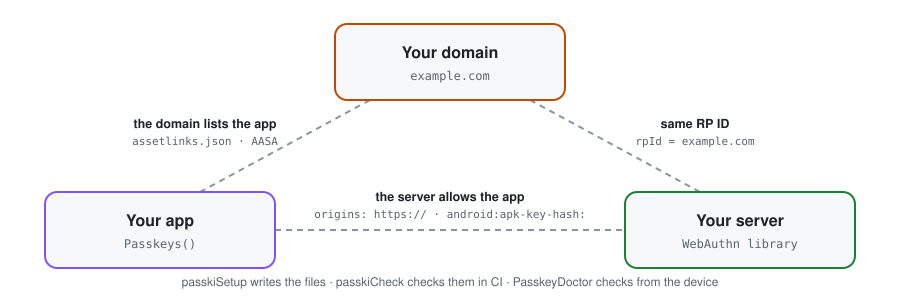

<h1 align="center">PassKi</h1>

<p align="center">
  <b>Passkeys for Kotlin Multiplatform.</b><br>
  One dependency, one call, native authenticators, and errors that tell you how to fix them.
</p>

<p align="center">
  
  
  
  
  <a href="https://central.sonatype.com/artifact/com.alirezaiyan.passki/passki"></a>
  
</p>

<table align="center">
  <tr>
    <th>Android 16 · Google Password Manager</th>
    <th>iOS 26.3 · Face ID</th>
  </tr>
  <tr>
    <td></td>
    <td></td>
  </tr>
</table>

<p align="center"><sub>The <a href="docs/try-it.md">sample app</a>: create a passkey, the server verifies it, sign out, sign back in.</sub></p>

## How it works

<p align="center">
  <picture>
    <source media="(prefers-color-scheme: dark)" srcset="docs/media/how-it-works-dark.svg">
    
  </picture>
</p>

Your server creates the options and verifies the result. PassKi does the part in between, from `commonMain`, on
Android, iOS and the web:

```kotlin
val passkeys = Passkeys() // no Activity, no UIWindow

passkeys.signIn(api.authenticationOptions())  // steps 1-3: your server's options, the sheet
    .onSuccess { api.finishSignIn(it.json) }  // step 4: your server verifies the response

passkeys.register(api.registrationOptions())  // creating a passkey: the same four steps
    .onSuccess { api.finishRegistration(it.json) }
```

<details>
<summary><b>What PassKi does, and what it leaves to you</b></summary>

- **Does:** shows the platform's own sheet (Credential Manager on Android, AuthenticationServices on iOS,
  `navigator.credentials` in the browser) and returns a typed `PasskeyResult` with the response JSON, unchanged.
- **Doesn't:** verify responses, store credentials, or call any server. Verifying is your server's job, with any
  WebAuthn library ([how](docs/guides/verify-on-server.md)). More: [Concepts](docs/concepts.md),
  [Security model](docs/security-model.md).
- **Tests without a device:** `FakePasskeys` signs real responses that webauthn4j and java-webauthn-server verify, so
  your app's and your server's tests run on the JVM ([Testing](docs/testing.md)).

</details>

<details>
<summary><b>When something goes wrong</b></summary>

Every failure is a `PasskeyError` with a `category` you can `when` over. A setup mistake says what to fix, and
PassKi logs it, so even a release build tells you:

```text
E PassKi  : signIn failed: Misconfigured [AND-03]: … Fix: add the SHA-256 fingerprint … Docs: …/checks/AND-03
```

When `error.isUserCancellation` is true, the user closed the sheet: show nothing.
[What to show users](docs/guides/what-to-show-users.md) · [Troubleshooting](docs/guides/troubleshooting.md) ·
[Logging](docs/logging.md)

</details>

## Setup: three things trust each other

<p align="center">
  <picture>
    <source media="(prefers-color-scheme: dark)" srcset="docs/media/setup-dark.svg">
    
  </picture>
</p>

The device only offers a passkey for `example.com` if `example.com` lists your app, and your server only accepts it
from origins it knows. Your domain is the RP ID, and it [can't change later](docs/guides/choosing-rp-id.md).

<details>
<summary><b>With the Gradle plugin</b></summary>

```kotlin
plugins { id("com.alirezaiyan.passki") version "0.1.0-alpha04" } // in your Android app module

passki { rpId = "example.com" }
```

`./gradlew passkiSetup` writes both well-known files and the iOS entitlement, and prints your server's allowed
origins. Upload the files to `https://example.com/.well-known/`, then `./gradlew passkiCheck` checks the live domain,
your Xcode project and your server (also in CI). [Setup tooling](docs/setup.md)

</details>

<details>
<summary><b>By hand</b></summary>

Serve `/.well-known/assetlinks.json` and `/.well-known/apple-app-site-association`, add `webcredentials:example.com`
to the iOS entitlements, and allow `https://example.com` plus one `android:apk-key-hash:` origin per signing key on
your server. [Checklist](docs/setup.md#server-setup-by-hand)

</details>

Either way, `PasskeyDoctor.run("example.com")` in a debug build checks it all from the device and prints each fix.

## Get started

```kotlin
commonMain.dependencies {
    implementation(project.dependencies.platform("com.alirezaiyan.passki:passki-bom:0.1.0-alpha04"))
    implementation("com.alirezaiyan.passki:passki") // the BOM keeps every PassKi library on one version
}
commonTest.dependencies { implementation("com.alirezaiyan.passki:passki-test") }
```

Android needs Kotlin 2.1+ and runs passkeys on Android 9+; iOS 16+ and the web need Kotlin 2.2+
([requirements](docs/usage.md#install)). Then:

- **[Quickstart](docs/quickstart.md):** your app and your own server to a first verified passkey, step by step.
- **[Try it](docs/try-it.md):** see it work first against the hosted demo server, with nothing to set up.

## Next

| Page | What's in it |
|---|---|
| [Guides](docs/README.md#guides) | Passkeys as an extra sign-in, what to show users, RP ID, server API and verification, upgrades |
| [Usage](docs/usage.md) | Every call, results and errors, signals |
| [Platforms](docs/platforms.md) | What each OS version supports, and how the platforms differ |
| [Troubleshooting](docs/guides/troubleshooting.md) | Symptom first: AND-03, Play builds, IOS-02, the web |
| [Security model](docs/security-model.md) | What PassKi does and doesn't do, and what your server must check |
| [All docs](docs/README.md) | Concepts, Compose, autofill, PRF and largeBlob, testing, logging, setup tooling, check catalog |

[API reference](https://rezaiyan.github.io/PassKi/) · [CHANGELOG](CHANGELOG.md) · [Versioning](docs/versioning.md) (what alpha, beta and 1.0 promise)

## License

Apache-2.0 © Ali Rezaiyan. Contributions welcome: see [CONTRIBUTING.md](CONTRIBUTING.md).
