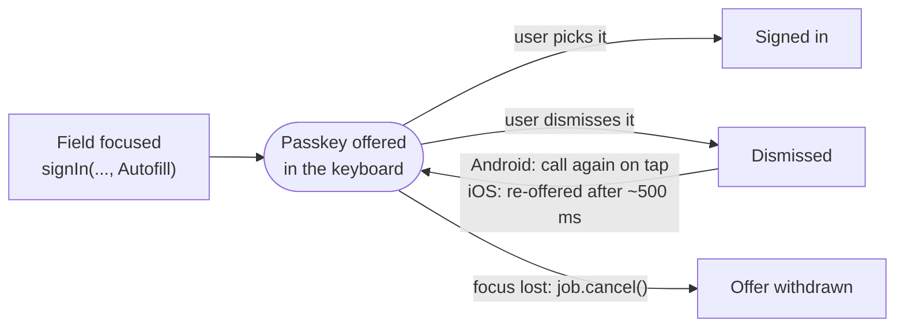

# Autofill sign-in

`SignInMode.Autofill` offers the person's passkeys as suggestions in the keyboard of a focused username field.
WebAuthn calls this "conditional mediation". It needs Android 15 (API 35) or newer, iOS 16 or newer, or a browser
with conditional mediation; check `capabilities().autofill`. In a browser, the suggestions appear in an HTML
`<input autocomplete="username webauthn">` on the page, which Compose for Web (drawn on a canvas) doesn't have.

`PasskeyUsernameField` from `passki-compose` does all of this for you. To use autofill with your own text field:

```kotlin
// Your username field must be focused (content type username) when you call this.
val job = scope.launch {
    passkeys.signIn(api.authenticationOptions(), SignInMode.Autofill)
        .onSuccess { api.finishSignIn(it.json) }
}
// When the field loses focus or leaves the screen:
job.cancel() // withdraws the offer
```



- **The call waits until the person picks a passkey.** Dismissing the suggestion or the sheet doesn't end it. Cancel
  the coroutine to withdraw the offer.
- **After a dismissal:**
  - On Android, the suggestion doesn't come back while the field stays focused. Cancel and call again, for example
    when the field is tapped. `PasskeyUsernameField` does this on every tap.
  - On iOS, PassKi offers the passkeys again by itself, about 500 ms after a dismissal.
- **Text already in the field (Android):** with Gboard on Android 16, the passkey suggestions showed while the
  username field was empty. Once the field had text, Gboard showed that text as a word suggestion instead. If your
  sign-out leaves the last username in the field, clear it.
- **Old suggestions on Android:** a suggestion that has been showing for more than about a minute can fail in Google
  Password Manager with "Flow has timed out". The next call offers a fresh one.
- **Errors:**
  - Below Android 15: `NotSupported`.
  - On Android, with no focused text field: `Misconfigured` ("Autofill needs a focused text field").
  - On iOS, when the app isn't linked to the domain: `Misconfigured`, as with the other calls.

---

[← README](../README.md)
