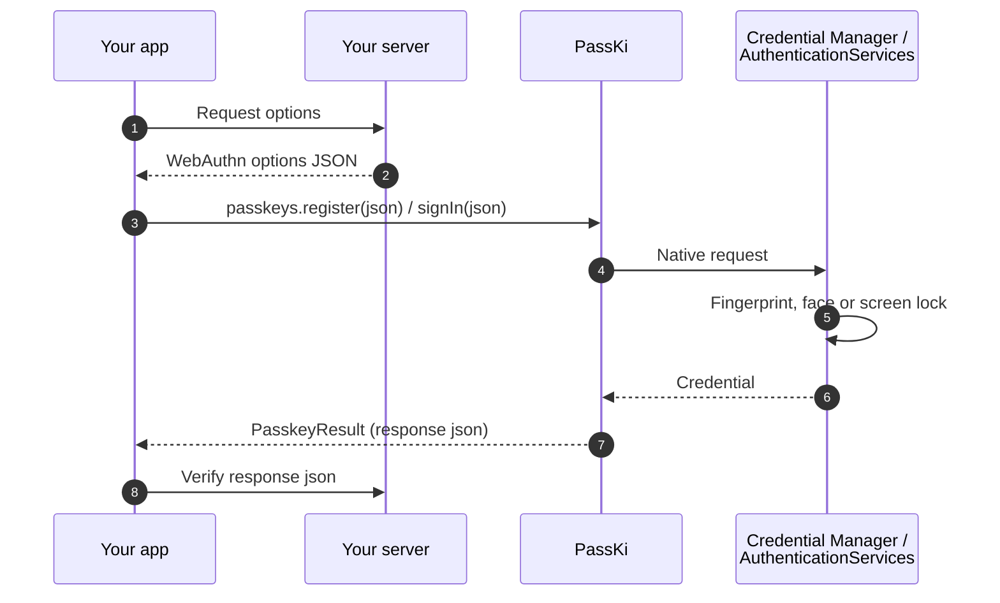

# Concepts

What PassKi does, how a passkey ceremony runs, and the words these docs use.

## Why PassKi

- **One API for Android, iOS and the web.** Call `register`, `signIn`, `signInOrPassword`, `upgrade` and `signals` from
  `commonMain`. You don't pass an `Activity` or a `UIWindow`.
- **Errors you can act on.** Every failure is a typed `PasskeyError`. A setup problem comes back as
  `PasskeyError.Misconfigured`, with a `fixHint` that says what to change and a check ID that links to its docs page.
  PassKi logs it too, so a release build still says why.
- **Setup that checks itself.** A Gradle plugin writes your well-known files and iOS entitlements, then checks your
  live domain. `PasskeyDoctor` runs the same checks on a device.
- **Ready for Compose.** `PasskeySignInButton`, and `PasskeyUsernameField`, which offers passkeys in the keyboard.
- **Testable without a device.** `FakePasskeys` returns real signed responses that server libraries such as webauthn4j
  and java-webauthn-server verify, so you can test your app and your server without a phone.

## How it works

PassKi sits between your app and the device's passkey system: Credential Manager on Android, AuthenticationServices on
iOS, `navigator.credentials` in the browser. Your server creates the options and checks the result. PassKi never talks
to your server and stores nothing ([security model](security-model.md)).

A passkey works only when three things trust each other: your app, a domain you own, and a server that checks each
sign-in. PassKi handles the app side, and its setup tools help with the other two.

## Words used here

| Term | Meaning |
|---|---|
| **Relying party** | The service people sign in to: your domain plus the server that checks passkeys. |
| **RP ID** | Your domain, such as `example.com`. Every passkey belongs to one RP ID, and it can't change later ([choosing one](guides/choosing-rp-id.md)). |
| **Options and response** | For each sign-up or sign-in, your server creates WebAuthn *options* (JSON). PassKi returns a *response* (JSON) for your server to check. |
| **User handle** | The random ID your server gives an account in the options (`user.id`), base64url. Never your account ID ([rules](guides/user-names.md)). |
| **Well-known files** | Two files on your domain that list the apps allowed to use its passkeys: `/.well-known/assetlinks.json` (Android) and `/.well-known/apple-app-site-association` (iOS). |
| **Associated domains** | The iOS entitlement `webcredentials:<domain>` that links your app to your domain. |
| **Credential provider** | Where passkeys are stored: Google Password Manager on most Android phones, iCloud Keychain on iOS, or a third-party password manager. |
| **Signals** | Messages that tell the credential provider what your server knows, such as which passkeys it deleted (WebAuthn Signal API). |
| **Check ID** | A code such as `AND-03` or `IOS-02` that names one setup check. Errors, `passkiCheck`, `PasskeyDoctor` and the web verifier all use the same IDs, and each ID has a [docs page](checks/README.md). |
