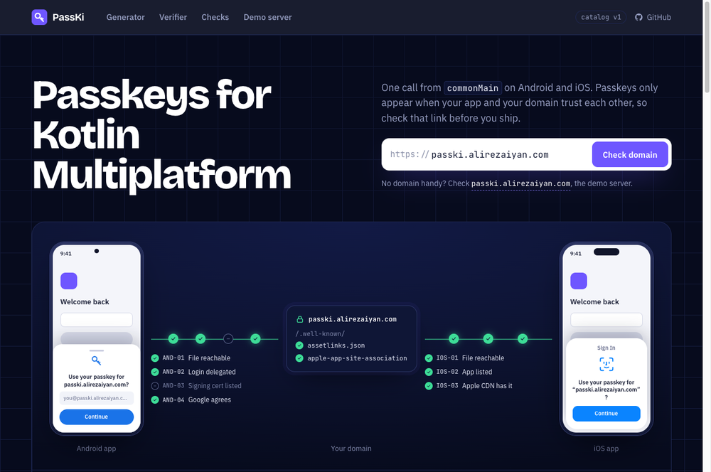
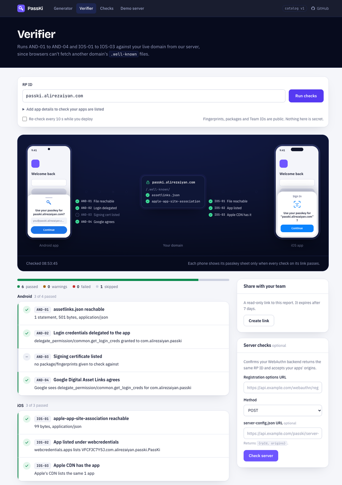

# Setup tooling

The Gradle plugin, `PasskeyDoctor`, the web dashboard and setting up by hand. For a first setup from scratch, follow
the [quickstart](quickstart.md#4-link-your-app-and-your-domain).

Most passkey problems are configuration: a missing fingerprint, a wrong Team ID, or a well-known file that redirects.
PassKi checks for these in three places, and all three use the same [check IDs](checks/README.md):

<p align="center">
  <picture>
    <source media="(prefers-color-scheme: dark)" srcset="media/setup-journey-dark.svg">
    
  </picture>
</p>

With the [Gradle plugin](#gradle-plugin) applied to your Android app module:

1. **Create the files and wire them up:** `./gradlew passkiSetup`. Add `--preview` to see every change first.
2. **Upload two files** from `build/passki/well-known/` to `https://<your domain>/.well-known/`. They must load with
   HTTP 200 and no redirect.
3. **Check everything:** `./gradlew passkiCheck`

`passkiSetup` never edits `project.pbxproj`, and you can run it again safely. It ends with a list of every file it
created or changed, with a diff for your own files. `passkiCheck` writes an HTML report. This is the report for the
sample app:

<p align="center">
  
</p>

## What passkiSetup does

- It writes the two well-known files: `assetlinks.json` (Android) and `apple-app-site-association` (iOS).
- It adds `webcredentials:<your domain>` to your iOS entitlements file.
- It connects that file to your Xcode build through `Configuration/Config.xcconfig` (the `CODE_SIGN_ENTITLEMENTS`
  setting). It never edits `project.pbxproj`.
- It writes your server's RP ID and allowed origins to `build/passki/server-config.json`, plus ready-made code for
  SimpleWebAuthn, webauthn4j, java-webauthn-server and py_webauthn.
- When the RP ID is a bare domain such as `example.com` and its live well-known files already list other apps, it
  warns: passkeys belong to the RP ID and can't move later, so a company domain shared by several products is usually
  the wrong choice, and a subdomain such as `app.example.com` is safer. The warning never fails the task; it is skipped
  with `--offline` and turned off with `-Ppasski.setup.sharedRpIdCheck=false`.

You can run it again at any time. It ends with a list of every file it created, changed or left unchanged, a diff of
your own files (entitlements, `xcconfig`), and the next steps. With `--preview` it prints the same list and writes
nothing:

```
$ ./gradlew passkiSetup --preview
passki setup summary (preview: nothing was written or sent)
  would create  androidApp/build/passki/well-known/assetlinks.json
  would change  iosApp/iosApp/iosApp.entitlements
      + 		<string>webcredentials:example.com</string>
  would change  iosApp/Configuration/Config.xcconfig
      + CODE_SIGN_ENTITLEMENTS = iosApp/iosApp.entitlements
  ...
next steps
  1. Upload androidApp/build/passki/well-known/assetlinks.json and ... to https://example.com/.well-known/ ...
```

With `useDemoServer()`, `passkiSetup` doesn't write well-known files or server config. Instead it registers your app
with the [demo server](#web-dashboard-and-demo-server) and prints each request and the server's answer.

## What passkiCheck does

`passkiCheck` prints one line per check, such as `[PASS] AND-01 ...`. Under each problem it prints a `fix:` line. It
also writes an HTML report. This is the report for the sample app:

<p align="center">
  
</p>

- Every check has a docs page: `docs/checks/<ID>.md`.
- The report is saved as `build/reports/passki/check.json` and `index.html`.
- `passkiCheck` fails the build when a check fails, so you can run it in CI. Add
  `-Ppasski.check.warningsAsErrors=true` to fail on warnings too.
- Without Xcode (for example on Linux CI), the Xcode checks are skipped.

## Gradle plugin

Apply it in your Android app module (the one with `com.android.application`):

- **iOS-only app:** apply it in any module. `passkiSetup` and `passkiCheck` then run without the Android part, and
  say so.
- **Wrong module** (for example `shared`): the tasks also run without Android, and tell you which module to apply the
  plugin to instead.

```kotlin
plugins {
    id("com.android.application")
    id("com.alirezaiyan.passki") version "0.1.0-alpha05"
}

passki {
    rpId = "example.com"
    apple {
        teamId = "ABCDE12345"
        bundleId = "com.example.app"
    }
}
```

### All options

```kotlin
passki {
    rpId = "example.com" // a bare domain: checked when a task runs, with the corrected value if it isn't
    android {
        // Fingerprints you can't derive from a local keystore, e.g. Play App Signing (colon-hex SHA-256).
        extraFingerprints.add("AB:CD:...")
    }
    apple {
        teamId = "ABCDE12345"
        bundleId = "com.example.app"
        entitlementsFile = rootProject.file("iosApp/iosApp/iosApp.entitlements") // optional
        // All optional; discovered from the KMP template layout when unset:
        // xcodeProject = rootProject.file("iosApp/iosApp.xcodeproj"); scheme = "iosApp"
        // xcconfig = rootProject.file("iosApp/Configuration/Config.xcconfig"); developerMode = true
    }
    server {
        // Optional, for passkiCheck SRV-01..03: GET returns {"rpId": "...", "origins": [...]} or registration options.
        configUrl = "https://example.com/passki/server-config"
    }
}
```

How the plugin finds your Android app's identity:

- It reads the package name and signing fingerprints from your Android build. `android { packageName = "..." }`
  overrides the base application ID.
- `assetlinks.json` gets one entry per package your build produces. For example, a build type with
  `applicationIdSuffix = ".debug"` gets its own `com.example.app.debug` entry, with only the debug key.
- `extraFingerprints` (such as the Play App Signing key) go to the packages of release builds.

### Tasks

| Task | What it does |
|---|---|
| `passkiSetup` | Writes the well-known files, the iOS entitlements and their `xcconfig` link, `server-config.json` and the server code. With `useDemoServer()`, registers the app with the demo server instead. Ends with a summary and next steps. `--preview` changes nothing. Reads `teamId` and `bundleId` from Xcode (`xcodebuild -showBuildSettings`) when you don't set them |
| `passkiCheck` | Runs the checks AND-01 to AND-05, IOS-01 to IOS-06 and SRV-01 to SRV-03, and writes `build/reports/passki/`. Needs network. Not part of `check` |
| `passkiFingerprints` | Prints the package, variant, keystore and SHA-256 fingerprint of each build variant, and the `android:apk-key-hash:` origins your server must allow |

Under "passki advanced" in `./gradlew tasks --all`:

- `passkiOrigin --sha256=<fingerprint> [--package=<applicationId>]` prints the `android:apk-key-hash:` origin and the
  `assetlinks.json` statement for one raw SHA-256, such as the Play App Signing key from Play Console. It works in any
  project, with or without an Android app, and `--package` defaults to `passki.android.packageName` or the app's
  `applicationId`.
- Two older tasks kept for existing scripts: `passkiWellKnown` (only the well-known files) and `passkiVerify` (only the
  hosted-file checks, without a report).

```
$ ./gradlew passkiFingerprints
passki signing fingerprints:
  package                | variant | keystore                         | SHA-256
  com.alirezaiyan.passki | debug   | .../androidApp/sample-debug.keystore | 59:E5:92:32:...:57:88:E2:06:C0
  com.alirezaiyan.passki | release | -                                | (no signing config)
Android WebAuthn origins (server allow-list):
  android:apk-key-hash:WeWSMk5s5vpf4vCKORgTLaUd3l35vRHwXOgjV4jiBsA
```

> [!WARNING]
> The plugin reads keystore passwords from your signing configs. They aren't used to decide whether a task is up to
> date, but Gradle stores them in its configuration cache, in `.gradle/configuration-cache/`. That folder stays on
> your machine. Don't share or upload it.

## PasskeyDoctor

`PasskeyDoctor` runs the setup checks on the device itself: platform support, screen lock, PassKi's startup, the
`INTERNET` permission, your hosted `assetlinks.json` (Android) or `apple-app-site-association` (iOS), and the origin
your server must allow.

<table>
<tr>
<td>

```kotlin
if (BuildConfig.DEBUG) {
    // suspend; bare domain, never throws for setup problems
    val report = PasskeyDoctor.run("example.com")
    println(report)
    // passkeys won't work until these are fixed
    report.failures.forEach { log(it.message, it.fixHint) }
    // likely trouble, not blocking
    report.warnings.forEach { log(it.message, it.fixHint) }
}
```

- **Debug builds only.** It makes network requests and never runs
  automatically.
- On platforms other than Android and iOS the report holds a single
  skipped check.
- A failing check prints a `fix:` line under it. The text is for
  humans; read `report.checks` (`id`, `name`, `status`, `message`,
  `fixHint`) instead of parsing it.

</td>
<td width="260">

<p align="center"><sub>The sample app's <b>Setup</b> tab: <code>PasskeyDoctor</code> plus the server checks, each with its catalog ID.</sub></p>
</td>
</tr>
</table>

## Web dashboard and demo server

[passki.alirezaiyan.com](https://passki.alirezaiyan.com) is a hosted relying party with a setup dashboard, built on
SimpleWebAuthn. Its source is in `passki-web/`. Type your domain on the home page, and it draws the links between your
Android app, your domain and your iOS app, turning each check green as it passes:

<p align="center">
  <a href="https://passki.alirezaiyan.com"></a>
</p>

- **Verifier:** enter your domain, and optionally your package, fingerprints, Team ID and bundle ID. The server
  downloads your well-known files, asks Google and Apple what they have cached, and runs the same checks (same IDs
  and fixes) as `passkiCheck`, grouped by platform. It checks again every 10 seconds while you deploy. It can also
  create a read-only report link that expires after 7 days, and optionally check your server's options endpoint (the
  SRV checks).

  <details>
  <summary>Screenshot</summary>

  <p align="center">
    
  </p>

  </details>

- **Generator:** enter your domain, packages, SHA-256 fingerprints, Team ID and bundle ID. You get both well-known
  files, the entitlements and `xcconfig` lines, and the list of origins your server must allow, as a zip.
- **Check docs:** one page per check ID, the same pages as [`docs/checks/`](checks/README.md).
- **Demo server:** a working relying party for trying PassKi ([Try it in your app](try-it.md#try-it-in-your-app)). Challenges are real and can be
  used once, and every response gets the server's verdict. Demo users are deleted after 24 hours.
  - To use it, your app must be registered with it. `passkiSetup` does that when your plugin block says
    `useDemoServer()`: it registers your Android package and signing keys, and your iOS `TEAM.bundle` app ID, for 7
    days. Registration is rate-limited per IP address.
  - iOS apps use the entitlement `webcredentials:passki.alirezaiyan.com?mode=developer`, which skips Apple's cache.
    You can also register an iOS app ID by hand on the demo page.
  - API: `/api/demo/register/options|verify`, `/api/demo/login/options|verify`, `/api/demo/server-config`, and the
    registration endpoints `/api/demo/android-apps` and `/api/demo/ios-apps`.

When the server downloads files for a check, it only fetches `https://<domain>/.well-known/…` and fixed Google and
Apple addresses. It refuses IP addresses and private or reserved networks, connects only to the address it checked
(so a DNS change can't redirect it mid-request), never follows redirects, and limits the time and size of every
download.

## Server setup by hand

If you don't use the Gradle plugin, you need the same four pieces it would generate:

1. **Android:** serve `/.well-known/assetlinks.json` with `delegate_permission/common.get_login_creds` for your
   package and the SHA-256 of each signing key: debug, upload and **Play App Signing** (from Play Console).
2. **iOS:** serve `/.well-known/apple-app-site-association` with `webcredentials.apps: ["<TeamID>.<bundleId>"]`.
   Apple's CDN caches it, so changes take a while to reach devices.
3. **iOS:** add `webcredentials:<your domain>` to the app's associated domains, turn on Associated Domains for the App
   ID, and **regenerate the App Store provisioning profile**. Debug builds work without the new profile; release
   signing in CI fails.
4. **Server:** RP ID `<your domain>`; allowed origins `https://<your domain>` plus one `android:apk-key-hash:<base64url
   SHA-256>` per Android signing key.

`PasskeyDoctor` checks the result from a debug build either way: see [PasskeyDoctor](#passkeydoctor). The details: Templates for both files are in
[`docs/setup/well-known/`](setup/well-known/README.md).

### Android: `assetlinks.json` and the origin

Serve `https://<your domain>/.well-known/assetlinks.json` with HTTP 200, no redirect and
`Content-Type: application/json`. It needs one statement per package, with the relation
`delegate_permission/common.get_login_creds` and the SHA-256 fingerprint of **every key that signs a build users
run**:

| Key | Where to find its SHA-256 |
|---|---|
| Debug | `keytool -list -v -keystore ~/.android/debug.keystore -storepass android` |
| Upload | `keytool -list -v -keystore <upload.jks>` |
| Play App Signing | Play Console → your app → Test and release → App integrity → App signing. It is in no local keystore |

Your server must also allow one origin per key. Android reports `android:apk-key-hash:` followed by the base64url
(no padding) SHA-256 bytes:

```bash
printf '%s' "AB:CD:...:EF" | tr -d ':' | xxd -r -p | base64 | tr '+/' '-_' | tr -d '='
```

```bash
python3 -c "import base64,sys;print(base64.urlsafe_b64encode(bytes.fromhex(sys.argv[1].replace(':',''))).decode().rstrip('='))" "AB:CD:...:EF"
```

Or apply the plugin anywhere in your build (it changes nothing until you run a task) and run
`./gradlew passkiOrigin --sha256=AB:CD:...:EF --package=com.example.app`. It prints the origin and the
`assetlinks.json` statement for that key.

### iOS: `apple-app-site-association` and the entitlement

- Serve `https://<your domain>/.well-known/apple-app-site-association` (no file extension, no redirect) with
  `{"webcredentials": {"apps": ["<TeamID>.<bundleId>"]}}`.
- Apple's CDN caches the file, so a change can take hours to reach devices. While developing, use
  `webcredentials:<your domain>?mode=developer` on a device with Developer Mode on to skip the CDN.
- Add `webcredentials:<your domain>` to `com.apple.developer.associated-domains` in your app's entitlements.
- **Turn on Associated Domains for the App ID in the Apple Developer portal, then regenerate your App Store (and
  ad hoc) provisioning profiles.** Debug builds with automatic signing keep working without this, so it often first
  shows up as a release-signing failure in CI: the profile doesn't include the
  `com.apple.developer.associated-domains` entitlement.

### Server

- RP ID: your domain, for example `example.com`.
- Allowed origins: `https://<your domain>` plus one `android:apk-key-hash:` origin per Android signing key above.
- With the plugin applied, `passkiSetup` writes ready-made verifier code for four server libraries to
  `build/passki/server-snippets/`. For webauthn4j, catch `RuntimeException` around
  `parseRegistrationResponseJSON` / `parseAuthenticationResponseJSON`: malformed JSON such as `{"id":"x"}` throws
  `NullPointerException`, not only `DataConversionException`, and should be a 400, not a 500.

Check the hosted files with the [web verifier](https://passki.alirezaiyan.com), or with `passkiCheck` if you apply the
plugin.

---

[← Docs](README.md)
