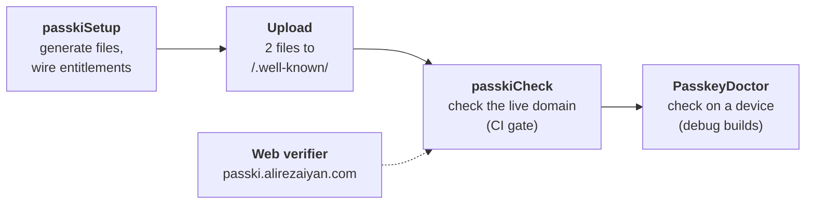

# Setup tooling

The Gradle plugin, `PasskeyDoctor` and the web dashboard in detail. The three steps are in the [README](../README.md#setup).

Most passkey failures are configuration: a missing fingerprint, a wrong Team ID, a redirecting `.well-known` file.
PassKi checks these in three places, and all three use the same check IDs from the
[check catalog](checks/README.md):



With the [Gradle plugin](#gradle-plugin) applied to your Android app module:

1. **Generate and wire everything:** `./gradlew passkiSetup` (add `--preview` to see every change first)
2. **Upload two files** from `build/passki/well-known/` to `https://<rpId>/.well-known/` (HTTP 200, no redirects).
3. **Check it end to end:** `./gradlew passkiCheck`

`passkiSetup` writes `assetlinks.json` and `apple-app-site-association`, and adds `webcredentials:<rpId>` to your iOS
entitlements. It wires them into Xcode through `Configuration/Config.xcconfig` (`CODE_SIGN_ENTITLEMENTS`; it never
edits `project.pbxproj`). It also writes your server's RP ID and origins to `build/passki/server-config.json`, plus
snippets for SimpleWebAuthn, webauthn4j, java-webauthn-server and py_webauthn. It is safe to re-run.

It ends with a summary of every file it created, changed or left unchanged, with a diff for your own files
(entitlements, `xcconfig`), then the next steps. `--preview` prints the same summary and writes nothing:

```
$ ./gradlew passkiSetup --preview
passki setup summary (preview: nothing was written or sent)
  would create  androidApp/build/passki/well-known/assetlinks.json
  would change  iosApp/iosApp/iosApp.entitlements
      + 		<string>webcredentials:example.com</string>
  would change  iosApp/Configuration/Config.xcconfig
      + CODE_SIGN_ENTITLEMENTS = iosApp/iosApp.entitlements
  ...
next steps
  1. Upload androidApp/build/passki/well-known/assetlinks.json and ... to https://example.com/.well-known/ ...
```

`passkiCheck` prints one line per check (`[PASS] AND-01 ...`, with a `fix:` line under each problem) and writes an
HTML report. This is the report for the sample app:

<p align="center">
  
</p>

- Every check has a docs page: `docs/checks/<ID>.md`.
- The report is written to `build/reports/passki/check.json` and `index.html`.
- `passkiCheck` exits non-zero on any failure, so it works as a CI gate. Add
  `-Ppasski.check.warningsAsErrors=true` to fail on warnings too.
- Without Xcode (Linux CI) the Xcode checks are skipped.

## Gradle plugin

Apply it in your Android application module (`com.android.application`). Without one (an iOS-only app), apply it
anywhere: `passkiSetup` and `passkiCheck` then run in iOS-only mode and say so. Applied to a module that isn't the
Android app (such as `shared`), they also run in iOS-only mode and name the module to apply it to instead.

```kotlin
plugins {
    id("com.android.application")
    id("com.alirezaiyan.passki") version "0.1.0-alpha02"
}

passki {
    rpId = "example.com"
    apple {
        teamId = "ABCDE12345"
        bundleId = "com.example.app"
    }
}
```

### All options

```kotlin
passki {
    rpId = "example.com" // a bare domain: checked when a task runs, with the corrected value if it isn't
    android {
        // Fingerprints you can't derive from a local keystore, e.g. Play App Signing (colon-hex SHA-256).
        extraFingerprints.add("AB:CD:...")
    }
    apple {
        teamId = "ABCDE12345"
        bundleId = "com.example.app"
        entitlementsFile = rootProject.file("iosApp/iosApp/iosApp.entitlements") // optional
        // All optional; discovered from the KMP template layout when unset:
        // xcodeProject = rootProject.file("iosApp/iosApp.xcodeproj"); scheme = "iosApp"
        // xcconfig = rootProject.file("iosApp/Configuration/Config.xcconfig"); developerMode = true
    }
    server {
        // Optional, for passkiCheck SRV-01..03: GET returns {"rpId": "...", "origins": [...]} or registration options.
        configUrl = "https://example.com/passki/server-config"
    }
}
```

The Android package and signing fingerprints are read from your Android build; `android { packageName = "..." }`
overrides the base application ID. `assetlinks.json` gets one statement per package the build produces, so a build
type with `applicationIdSuffix = ".debug"` gets its own `com.example.app.debug` statement with only the debug key.
`extraFingerprints` go to the packages of non-debuggable variants.

### Tasks

| Task | What it does |
|---|---|
| `passkiSetup` | Writes the well-known files, iOS entitlements and their `xcconfig` wiring, `server-config.json` and verifier snippets (with `useDemoServer()`: registers the app with the demo server instead of writing well-known files and server config); ends with a summary and next steps. `--preview` changes nothing. `teamId`/`bundleId` default to `xcodebuild -showBuildSettings` |
| `passkiCheck` | Runs the catalog checks AND-01..05, IOS-01..06 and SRV-01..03 and writes `build/reports/passki/`. Needs network and is not part of `check` |
| `passkiFingerprints` | Prints package, variant, keystore and SHA-256 per variant, plus the `android:apk-key-hash:` origins for your server allow-list |

Two more tasks are listed under "passki advanced" in `./gradlew tasks --all` and are kept for existing scripts:
`passkiWellKnown` (only the well-known files of `passkiSetup`) and `passkiVerify` (only the hosted-file checks of
`passkiCheck`, without a report).

```
$ ./gradlew passkiFingerprints
passki signing fingerprints:
  package                | variant | keystore                         | SHA-256
  com.alirezaiyan.passki | debug   | .../androidApp/sample-debug.keystore | 59:E5:92:32:...:57:88:E2:06:C0
  com.alirezaiyan.passki | release | -                                | (no signing config)
Android WebAuthn origins (server allow-list):
  android:apk-key-hash:WeWSMk5s5vpf4vCKORgTLaUd3l35vRHwXOgjV4jiBsA
```

> [!WARNING]
> Keystore passwords are read from your signing configs but are not tracked task inputs (up-to-date checks use the
> keystore file, alias and type). They are stored in the configuration-cache entry under
> `.gradle/configuration-cache/`, which stays on your machine: don't share or upload that directory.

## PasskeyDoctor

`PasskeyDoctor` runs the same checks on the device: platform support, screen lock, PassKi initialisation, the
`INTERNET` permission, your hosted `assetlinks.json` (Android) or `apple-app-site-association` (iOS), and the origin
your server must allow.

<table>
<tr>
<td>

```kotlin
if (BuildConfig.DEBUG) {
    // suspend; bare domain, never throws for setup problems
    val report = PasskeyDoctor.run("example.com")
    println(report)
    // passkeys won't work until these are fixed
    report.failures.forEach { log(it.message, it.fixHint) }
    // likely trouble, not blocking
    report.warnings.forEach { log(it.message, it.fixHint) }
}
```

- **Debug builds only.** It makes network requests and never runs
  automatically.
- On platforms other than Android and iOS the report holds a single
  skipped check.
- A failing check prints a `fix:` line under it. The text is for
  humans; read `report.checks` (`id`, `name`, `status`, `message`,
  `fixHint`) instead of parsing it.

</td>
<td width="260">

<p align="center"><sub>The sample app's <b>Setup</b> tab: <code>PasskeyDoctor</code> plus the server checks, each with its catalog ID.</sub></p>
</td>
</tr>
</table>

## Web dashboard and demo server

[passki.alirezaiyan.com](https://passki.alirezaiyan.com) is a hosted relying party with a setup dashboard, built on
SimpleWebAuthn. Its source is in `passki-web/`. Type your domain on the home page and it draws the trust link between
your Android app, your domain and your iOS app, turning each check green as it passes:

<p align="center">
  <a href="https://passki.alirezaiyan.com"></a>
</p>

- **Verifier:** enter your RP ID, and optionally your package, fingerprints, Team ID and bundle ID. The server fetches
  your `assetlinks.json` and `apple-app-site-association`, asks Google Digital Asset Links and the Apple CDN, and runs
  the same catalog checks (same IDs and fixes) as `passkiCheck`, grouped by platform. It re-checks every 10 s while
  you deploy, and can create a read-only report link that expires after 7 days. Optionally it checks your server's
  options endpoint (SRV checks).

  <details>
  <summary>Screenshot</summary>

  <p align="center">
    
  </p>

  </details>

- **Generator:** enter the RP ID, packages, SHA-256 fingerprints, Team ID and bundle ID, and get both well-known files,
  the entitlements and `xcconfig` lines and the server origin allow-list, as a zip.
- **Check docs:** one page per check ID, the same pages as [`docs/checks/`](checks/README.md).
- **Self-service iOS demo:** your Team ID differs from ours, so register your `TEAM.bundle` app ID on the demo page.
  It is listed in the demo `apple-app-site-association` for 7 days. Use it with
  `webcredentials:passki.alirezaiyan.com?mode=developer`. Registration is rate-limited per IP.
- **Demo RP API:** `/api/demo/register/options|verify`, `/api/demo/login/options|verify` and
  `/api/demo/server-config`. Challenges are real and single-use, and each response gets a server verdict. Demo users
  expire after 24 hours.

The server fetches only `https://<domain>/.well-known/…` and the fixed Google and Apple endpoints. It blocks IP
literals and private or reserved addresses, pins the validated DNS answer, never follows redirects, and caps the time
and size of every fetch.

## Server setup by hand

If you don't use the Gradle plugin:

- **Android:** serve `https://<rpId>/.well-known/assetlinks.json` with `delegate_permission/common.get_login_creds`
  and your signing SHA-256. Allow the origin `android:apk-key-hash:<base64url-sha256>` in your verifier.
- **iOS:** add the Associated Domains `webcredentials:<rpId>` entitlement and serve
  `/.well-known/apple-app-site-association`.
- See [`docs/setup/well-known/`](setup/well-known/README.md) for templates.

---

[← README](../README.md)
